# Learn SCSS 🎨

<div align="center">

[](https://opensource.org/licenses/MIT)
[](https://sass-lang.com/)
[](https://github.com/TheLearningHubOrg/learn-scss/actions/workflows/ci.yml)
[](https://github.com/TheLearningHubOrg/learn-scss/releases)
[](https://sass-lang.com/documentation/at-rules/use/)
[](https://www.oddbird.net/true/)

**From your first `sass` command to staff-level design-system architecture with modern Dart Sass.**  
The module system, maps and functions, colour spaces and WCAG contrast, mixins and control flow, the 7-1 layout, BEM, design tokens, cascade layers, tooling and migration off `@import`.

[Getting Started](#1-stage-1-dart-sass-toolchain-syntax--the-compilation-model) • [Modules](#2-stage-2-the-module-system-with-use-and-forward) • [Data & Functions](#3-stage-3-data-types-maps-lists-functions--math) • [Mixins & Control Flow](#4-stage-4-mixins-content-blocks--control-flow) • [Architecture](#5-stage-5-7-1-architecture-bem--design-tokens) • [Production](#6-stage-6-responsive-layout-tooling--production-builds) • [Interview Prep](#7-stage-7-staff-scss-design-systems-engineer-interview-handbook--cheatsheet)

<br/>

<a href="https://www.buymeacoffee.com/manthanank">
  
</a>

</div>

---

Every example in this guide is written in **SCSS**, plus the HTML that uses the compiled CSS, because SCSS is the syntax the Sass team recommends and the one almost every framework and design system ships. The starter project's tests are SCSS too: they use [sass-true](https://www.oddbird.net/true/), which asserts on Sass values and compiled CSS from inside Sass. A short `tests/sass.test.js` only hands those SCSS suites to Node's built-in test runner, because Dart Sass itself is distributed through npm.

## 🗺️ 7-Stage Pedagogical Roadmap

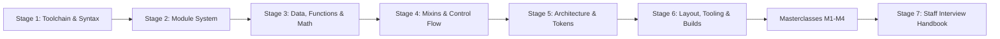

| Stage | Focus Domain | Core Concepts & Engineering Outcomes |
| :--- | :--- | :--- |
| **Stage 1** | **Dart Sass Toolchain, Syntax & the Compilation Model** | `npm i -D sass`, `sass src:dist`, `--watch`, `--style`, source maps, `--fatal-deprecation`; nesting with `&`, declaration order, `$variables`, `!default`, `!global`, interpolation `#{}`, comment types. Outcome: compile, watch and read the starter project. |
| **Stage 2** | **The Module System with `@use` and `@forward`** | Why `@import` is deprecated, namespaces, `as *`, load paths, `_index.scss` barrels, `pkg:` URLs, `@forward show/hide/as prefix-*`, `@use ... with`, private `$-members`, `meta.load-css()`. Outcome: split a stylesheet into encapsulated, configurable modules. |
| **Stage 3** | **Data Types, Maps, Lists, Functions & Math** | Value types and `meta.type-of()`, units and `math.div()`, first-class `calc()`, `sass:list`, nested `sass:map` operations, `@function` with `@error`/`@warn`/`@debug`, colour spaces (`oklch`, `color.to-gamut()`), WCAG contrast, fluid `clamp()`, testing with sass-true. Outcome: token lookups and colour maths that fail the build on bad input. |
| **Stage 4** | **Mixins, Content Blocks & Control Flow** | `@mixin` parameters, keyword and rest arguments, `@content` with arguments, `@if`/`@else`, `@each` over maps, `@for`, `@while`, placeholder selectors and `@extend`. Outcome: generate utilities and component variants from data. |
| **Stage 5** | **7-1 Architecture, BEM & Design Tokens** | The 7-1 folders, an ordering-only `main.scss`, BEM naming and nesting depth, tokens published as CSS custom properties, theme switching with `[data-theme]`. Outcome: a stylesheet structure a team of twenty can work in. |
| **Stage 6** | **Responsive Layout, Tooling & Production Builds** | Breakpoint mixins, container queries, fluid typography, Stylelint, PostCSS/Autoprefixer/cssnano, bundler integration, CI. Outcome: a linted, minified, cache-friendly CSS build. |
| **Masterclasses** | **Theming, cascade layers, `@import` migration, flagship design-system engine** | Token pipelines to runtime themes, `@layer` with `meta.load-css()`, `sass-migrator` at scale, and an end-to-end design-system core. |
| **Stage 7** | **Staff Interview Handbook** | Interview Q&As on the module system, compilation internals, architecture and debugging scenarios, plus a one-page cheatsheet. |

---

## 🆕 Sass Versions, What's New & Migration

Dart Sass is the only maintained Sass implementation. It ships a minor release every few weeks and still uses 1.x version numbers: language removals are held back for Dart Sass 2.0.0 and 3.0.0, and each one is announced first as a named deprecation that you can turn into a hard error today. This guide targets **Dart Sass 1.107** (current stable in November 2026).

### V.1 Release Timeline

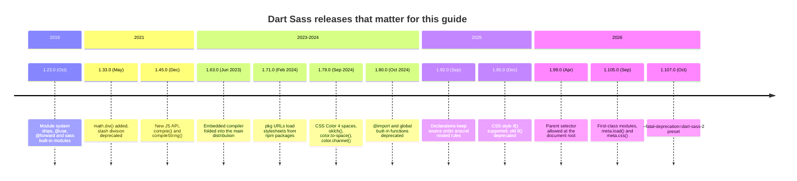

### V.2 Compatibility Matrix

| Implementation / package | Status (Nov 2026) | Runs on | Module system | Colour spaces | Notes |
| --- | --- | --- | --- | --- | --- |
| `sass` on npm (Dart Sass compiled to JS) | Current stable 1.107 | Node.js 20.19+ | Yes | Yes | Pure JS, works everywhere Node runs; slower than the native compiler on large projects. |
| `sass-embedded` on npm | Current stable 1.107 | Node.js 20.19+ on supported OS/CPU | Yes | Yes | Same API as `sass`, but talks to a native Dart Sass binary. Usually the fastest choice for bundlers. |
| Standalone Dart Sass binary | Current stable 1.107 | Linux, macOS, Windows | Yes | Yes | Download from the GitHub releases page or a package manager; no Node needed. |
| LibSass / `node-sass` | Deprecated (LibSass since Oct 2020; `node-sass` marked unsupported on npm) | Native addon | No | No | Stuck on 2010s syntax: no `@use`, no `math.div()`. Replace it. |
| Ruby Sass | End of life (March 2019) | Ruby | No | No | Historical only. |

| Tool | Sass integration in its current stable release |
| --- | --- |
| Vite | Install `sass` or `sass-embedded` and import `.scss` files; Vite uses the modern Sass JS API. |
| webpack `sass-loader` | Uses the modern API by default; prefer `sass-embedded` as the implementation for speed. |
| Angular CLI | Bundles Dart Sass; component `styleUrl` files may be `.scss`. |
| Stylelint | `stylelint-config-standard-scss` (current stable 17.x) understands SCSS syntax and Sass at-rules. |

### V.3 What's New in Dart Sass 1.107

#### Deprecation presets for Dart Sass 2.0.0 (1.107.0)

You can now ask the compiler to fail on everything that 2.0.0 will remove, in one flag. The starter project's `npm run build` uses it, so CI breaks the day new code depends on behaviour that is going away.

```bash
# Before: list each deprecation by name and keep the list current yourself
sass --fatal-deprecation=slash-div --fatal-deprecation=new-global src/scss/main.scss out.css

# After: one preset for everything Dart Sass 2.0.0 will turn into an error
sass --fatal-deprecation=dart-sass-2 src/scss/main.scss out.css

# Everything deprecated as of 1.107.0 except @import (still migrating)
sass --fatal-deprecation=1.107.0,-import src/scss/main.scss out.css
```

#### First-class modules (1.105.0)

Modules joined functions and mixins as values: `meta.load()` and `meta.get-module()` return a module, and the `meta.css()` mixin emits a module's CSS. Most code will keep using `@use` and `meta.load-css()`; the new functions are for libraries that pick modules at runtime. Check the official `sass:meta` reference before relying on the exact signatures, which are new.

#### Root-level parent selector (1.99.0)

A `&` outside any rule used to be an error. It is now passed through as the CSS scoping root, which matters inside `@scope` blocks and in plain CSS files loaded through Sass.

```scss
// Before 1.99.0: "Top-level selectors may not contain the parent selector &."
// Now: emitted unchanged as CSS nesting at the scoping root
& .x {
  color: red;
}
```

#### CSS-style `if()` (1.95.0)

Sass now parses the CSS `if()` function, and adds a `sass()` condition that is evaluated at compile time. The old three-argument form is deprecated (`if-function`).

```scss
$compact: true;

// Before (deprecated)
.a { padding: if($compact, 4px, 8px); }

// After
.a { padding: if(sass($compact): 4px; else: 8px); }
```

#### Declarations keep their source order (1.92.0)

A declaration written after a nested rule used to be hoisted above it. Sass now emits it where you wrote it, which splits the rule in two. The old `mixed-decls` deprecation warned about exactly this case; see [1.5](#15-nesting-and-the-parent-selector-) for how to write rules that compile to one block.

```scss
.a {
  color: red;
  &:hover { color: blue; }
  background: white; // now emitted in a second `.a { }` block after .a:hover
}
```

#### CSS Color 4 colour spaces (1.79.0)

Colours remember the space they were written in, and the `sass:color` functions accept `$space`. Adjusting lightness in `oklch` changes perceived lightness evenly across hues, which the old HSL-based `darken()` never did. [3.7](#37-colour-functions-and-colour-spaces) covers the API.

```scss
@use "sass:color";

// Before: HSL lightness, deprecated global function
.btn:hover { background: darken(#4f46e5, 10%); }

// After: perceptual lightness in OKLCH, then mapped back into sRGB
.btn:hover {
  background: color.to-gamut(
    color.adjust(#4f46e5, $lightness: -8%, $space: oklch),
    $space: rgb,
    $method: local-minde
  );
}
```

### V.4 Migration Guide (LibSass or older Dart Sass → 1.107)

```bash
# 1. Swap the compiler. Remove node-sass, install Dart Sass (pick one).
npm uninstall node-sass
npm install --save-dev sass            # pure JS
npm install --save-dev sass-embedded   # native binary, same API, faster

# 2. See every deprecation the codebase triggers, with IDs.
npx sass --verbose src/scss/main.scss /tmp/out.css 2>&1 | grep 'DEPRECATION WARNING \['

# 3. Fix division first: rewrites a / b into math.div(a, b) where it is division.
npx sass-migrator --migrate-deps division src/scss/main.scss

# 4. Move @import to @use/@forward and global functions to module functions.
#    --migrate-deps follows the whole graph; add --forward=all for a library entry point.
npx sass-migrator --migrate-deps module src/scss/main.scss

# 5. Update the deprecated colour functions such as color.red() to color.channel().
#    (The migrator also ships an if() migration for the old three-argument if().)
npx sass-migrator --migrate-deps color src/scss/main.scss

# 6. Lock it in: fail the build on anything Dart Sass 2.0.0 will remove.
npx sass --fatal-deprecation=dart-sass-2 src/scss/main.scss dist/main.css
```

In bundler configs, delete options that only the legacy JS API understood (`importer` callbacks written for `render()`, `outputStyle`, `includePaths`) and use the modern names (`importers`, `style`, `loadPaths`). [M3](#m3-masterclass-migrating-a-large-codebase-off-import) walks through a staged migration of a large codebase.

### V.5 Deprecations & Breaking Changes

| Version | Deprecated / removed | Replacement | What breaks and how to fix it |
| --- | --- | --- | --- |
| 1.33.0 | `/` as division (`slash-div`) | `math.div($a, $b)` or `calc()` | Warns today, removed in 2.0.0. Run `sass-migrator division`. |
| 1.45.0 (warns since 1.79) | Legacy JS API `render()`/`renderSync()` (`legacy-js-api`) | `compile()`, `compileAsync()`, `compileString()` | Old bundler plugins print warnings; upgrade the plugin or switch its API option. Removed in 2.0.0. |
| 1.79.0 | Channel functions such as `color.red()`, `color.hue()` | `color.channel($c, "red", $space: rgb)` | Still work with a warning; they assume legacy colour spaces. |
| 1.79.0 | `lighten()`, `darken()`, `saturate()`, `fade-out()` and friends | `color.adjust()` or `color.scale()` with an explicit `$space` | They only ever worked in HSL; `sass-migrator module` rewrites them to `color.adjust()`. |
| 1.80.0 | `@import` (`import`) | `@use` and `@forward` | Removal planned for 3.0.0. Run `sass-migrator module`. |
| 1.80.0 | Global built-ins such as `darken()`, `map-get()` (`global-builtin`) | Module functions: `color.adjust()`, `map.get()` | Removal planned for 3.0.0. `sass-migrator module` rewrites them. |
| 1.17.2 | `!global` creating a new variable (`new-global`) | Declare `$x: null` at the root first | Error in 2.0.0. |
| 1.92.0 | Hoisting declarations above nested rules (breaking change) | Write declarations before nested rules | CSS output order changes; rules may split in two. |
| 1.92.0 | Configuring private `$-variables` with `with` | Make the variable public with `!default` | Private configuration will become an error. |
| 1.95.0 | Sass `if($cond, $a, $b)` (`if-function`) | `if(sass($cond): $a; else: $b)` | Warning now. |
| 1.86.0 / 1.92.0 | User functions named `type()` | Rename the function | `type` is reserved for the CSS function; defining it is an error since 1.92.0. |

---

## 📋 Table of Contents

- [🆕 Sass Versions, What's New & Migration](#-sass-versions-whats-new--migration)
- [1. Stage 1: Dart Sass Toolchain, Syntax & the Compilation Model](#1-stage-1-dart-sass-toolchain-syntax--the-compilation-model)
  - [1.1 What Sass Is and the Problem It Solves](#11-what-sass-is-and-the-problem-it-solves)
  - [1.2 Dart Sass, the Embedded Host and the Dead Implementations](#12-dart-sass-the-embedded-host-and-the-dead-implementations)
  - [1.3 Installation & First Compile](#13-installation--first-compile)
  - [1.4 Line-by-Line Breakdown of the Starter Project](#14-line-by-line-breakdown-of-the-starter-project)
  - [1.5 Nesting and the Parent Selector &](#15-nesting-and-the-parent-selector-)
  - [1.6 Variables, Scope & Flags](#16-variables-scope--flags)
  - [1.7 Interpolation, Comments and Placeholders](#17-interpolation-comments-and-placeholders)
  - [1.8 Output Styles, Source Maps & Deprecation Controls](#18-output-styles-source-maps--deprecation-controls)
  - [1.9 Pitfalls](#19-pitfalls)
  - [1.10 Best Practices](#110-best-practices)
  - [1.11 Hands-on Exercise](#111-hands-on-exercise)
- [2. Stage 2: The Module System with @use and @forward](#2-stage-2-the-module-system-with-use-and-forward)
  - [2.1 Why @import Was Deprecated](#21-why-import-was-deprecated)
  - [2.2 Loading Modules with @use](#22-loading-modules-with-use)
  - [2.3 Namespaces: Default, Custom and Global](#23-namespaces-default-custom-and-global)
  - [2.4 How Sass Resolves a URL](#24-how-sass-resolves-a-url)
  - [2.5 Re-exporting with @forward](#25-re-exporting-with-forward)
  - [2.6 Configuring Modules with with and !default](#26-configuring-modules-with-with-and-default)
  - [2.7 Private Members & Encapsulation](#27-private-members--encapsulation)
  - [2.8 Built-in Modules and meta.load-css()](#28-built-in-modules-and-metaload-css)
  - [2.9 Pitfalls](#29-pitfalls)
  - [2.10 Best Practices](#210-best-practices)
  - [2.11 Hands-on Exercise](#211-hands-on-exercise)
- [3. Stage 3: Data Types, Maps, Lists, Functions & Math](#3-stage-3-data-types-maps-lists-functions--math)
  - [3.1 Value Types and meta.type-of()](#31-value-types-and-metatype-of)
  - [3.2 Numbers, Units & sass:math](#32-numbers-units--sassmath)
  - [3.3 Strings and Interpolation in Values](#33-strings-and-interpolation-in-values)
  - [3.4 Lists & sass:list](#34-lists--sasslist)
  - [3.5 Maps & sass:map](#35-maps--sassmap)
  - [3.6 Writing Functions with @function and @error](#36-writing-functions-with-function-and-error)
  - [3.7 Colour Functions and Colour Spaces](#37-colour-functions-and-colour-spaces)
  - [3.8 Computing WCAG Contrast](#38-computing-wcag-contrast)
  - [3.9 Fluid Values with clamp()](#39-fluid-values-with-clamp)
  - [3.10 Testing Functions with sass-true](#310-testing-functions-with-sass-true)
  - [3.11 Pitfalls](#311-pitfalls)
  - [3.12 Best Practices](#312-best-practices)
  - [3.13 Hands-on Exercise](#313-hands-on-exercise)
- [4. Stage 4: Mixins, Content Blocks & Control Flow](#4-stage-4-mixins-content-blocks--control-flow)
  - [4.1 Mixin Ergonomics with Default Parameters](#41-mixin-ergonomics-with-default-parameters)
  - [4.2 Content Blocks with @content](#42-content-blocks-with-content)
  - [4.3 Accessible Focus Ring Mixin](#43-accessible-focus-ring-mixin)
  - [4.4 Multi-Line Text Clamping](#44-multi-line-text-clamping)
  - [4.5 Responsive Auto-Fitting CSS Grid](#45-responsive-auto-fitting-css-grid)
  - [4.6 Dynamic Utility Generation with @each Loops](#46-dynamic-utility-generation-with-each-loops)
  - [4.7 Responsive Grid Generator with @for Loops](#47-responsive-grid-generator-with-for-loops)
  - [4.8 Algorithmic Elevation Shadow Matrix](#48-algorithmic-elevation-shadow-matrix)
  - [4.9 Mixins, @extend and Placeholders Compared](#49-mixins-extend-and-placeholders-compared)
  - [4.10 Pitfalls](#410-pitfalls)
  - [4.11 Best Practices](#411-best-practices)
- [5. Stage 5: 7-1 Architecture, BEM & Design Tokens](#5-stage-5-7-1-architecture-bem--design-tokens)
  - [5.1 The 7-1 Architecture Breakdown](#51-the-7-1-architecture-breakdown)
  - [5.2 Entry Point Architecture (main.scss)](#52-entry-point-architecture-mainscss)
  - [5.3 The BEM Naming Convention](#53-the-bem-naming-convention)
  - [5.4 Nesting Hygiene & the Inception Rule](#54-nesting-hygiene--the-inception-rule)
  - [5.5 Compiling Tokens into CSS Custom Properties](#55-compiling-tokens-into-css-custom-properties)
  - [5.6 Pitfalls](#56-pitfalls)
  - [5.7 Best Practices](#57-best-practices)
- [6. Stage 6: Responsive Layout, Tooling & Production Builds](#6-stage-6-responsive-layout-tooling--production-builds)
  - [6.1 Mobile-First Breakpoint Engine](#61-mobile-first-breakpoint-engine)
  - [6.2 Container Queries with SCSS](#62-container-queries-with-scss)
  - [6.3 Fluid Typography with clamp()](#63-fluid-typography-with-clamp)
  - [6.4 Production Build Pipeline](#64-production-build-pipeline)
  - [6.5 Build Scripts in package.json](#65-build-scripts-in-packagejson)
  - [6.6 Stylelint Configuration](#66-stylelint-configuration)
  - [6.7 Pitfalls](#67-pitfalls)
  - [6.8 Best Practices](#68-best-practices)
- [M1. Masterclass: Design Tokens to Runtime Theming](#m1-masterclass-design-tokens-to-runtime-theming)
  - [M1.1 How the Engine Works](#m11-how-the-engine-works)
  - [M1.2 Complete Worked Example](#m12-complete-worked-example)
  - [M1.3 Trade-offs Against the Alternatives](#m13-trade-offs-against-the-alternatives)
  - [M1.4 Production Checklist](#m14-production-checklist)
- [M2. Masterclass: Cascade Layers & Specificity Control](#m2-masterclass-cascade-layers--specificity-control)
  - [M2.1 How Layer Order Is Decided, and Where Sass Interferes](#m21-how-layer-order-is-decided-and-where-sass-interferes)
  - [M2.2 Complete Worked Example](#m22-complete-worked-example)
  - [M2.3 Trade-offs Against the Alternatives](#m23-trade-offs-against-the-alternatives)
  - [M2.4 Production Checklist](#m24-production-checklist)
- [M3. Masterclass: Migrating a Large Codebase off @import](#m3-masterclass-migrating-a-large-codebase-off-import)
  - [M3.1 How the Module Migrator Works](#m31-how-the-module-migrator-works)
  - [M3.2 Complete Worked Example](#m32-complete-worked-example)
  - [M3.3 Trade-offs: Big Bang or Incremental](#m33-trade-offs-big-bang-or-incremental)
  - [M3.4 Production Checklist](#m34-production-checklist)
- [M4. Masterclass: Flagship Blueprint, a Design System Core Engine](#m4-masterclass-flagship-blueprint-a-design-system-core-engine)
  - [M4.1 How the Pieces Fit](#m41-how-the-pieces-fit)
  - [M4.2 Complete Worked Example](#m42-complete-worked-example)
  - [M4.3 Trade-offs: One File or the 7-1 Split](#m43-trade-offs-one-file-or-the-7-1-split)
  - [M4.4 Production Checklist](#m44-production-checklist)
- [7. Stage 7: Staff SCSS Design Systems Engineer Interview Handbook & Cheatsheet](#7-stage-7-staff-scss-design-systems-engineer-interview-handbook--cheatsheet)
  - [7.1 Core Concepts (Q1-Q10)](#71-core-concepts-q1-q10)
  - [7.2 Internals & Performance (Q11-Q20)](#72-internals--performance-q11-q20)
  - [7.3 Architecture & Design (Q21-Q25)](#73-architecture--design-q21-q25)
  - [7.4 Scenario & Debugging Questions (Q26-Q28)](#74-scenario--debugging-questions-q26-q28)
  - [7.5 Staff Cheatsheet](#75-staff-cheatsheet)
- [🧪 Example Projects](#-example-projects)
- [📝 Cheat Sheets](#-cheat-sheets)
- [📚 Resources](#-resources)
- [🤝 Contributing](#-contributing)
- [📄 License](#-license)
- [🙏 Acknowledgments](#-acknowledgments)
- [🌐 Connect with me](#-connect-with-me)
- [☕ Support](#-support)

---


## 1. Stage 1: Dart Sass Toolchain, Syntax & the Compilation Model

This stage gets Dart Sass installed and compiling, then covers the syntax you meet on the first page of any SCSS codebase: nesting, the parent selector, variables and their scope, interpolation and comments. You need to know plain CSS selectors and the cascade. Afterwards you can compile, watch and debug the starter project and explain every line of its entry point.

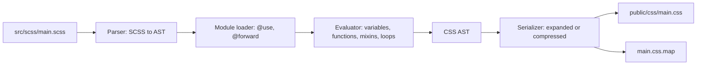

### 1.1 What Sass Is and the Problem It Solves

Sass is a stylesheet language that compiles to CSS. You write `.scss` files, a compiler evaluates the Sass parts (variables, functions, loops, modules) and writes plain CSS that browsers load. Nothing Sass-specific reaches the browser: there is no runtime, no JavaScript and no extra request.

Sass has two syntaxes. **SCSS** (`.scss`) is a superset of CSS: every valid CSS file is valid SCSS, and blocks use braces and semicolons. The **indented syntax** (`.sass`) drops braces and semicolons in favour of indentation. Both compile through the same engine and can `@use` each other. This guide uses SCSS, because that is what frameworks, design systems and linters expect.

CSS has caught up on several features that once justified Sass. Native nesting is Baseline since late 2023, custom properties are everywhere, and `@layer`, `color-mix()`, `clamp()` and container queries need no preprocessor. Sass still earns its place for work that must happen before the browser sees the file:

| Need | Native CSS (2026) | Sass | Which to use |
| --- | --- | --- | --- |
| Nesting | `.card { &:hover {} }` | Same, plus suffixes `&__title` | Sass if you use BEM suffixes; native nesting cannot build `.card__title` from `&__title`. |
| Variables | `--brand: #4f46e5;` resolved at runtime | `$brand: #4f46e5;` resolved at build time | Both: Sass maps as the source, custom properties for runtime theming ([5.5](#5-stage-5-7-1-architecture-bem--design-tokens)). |
| Loops and generated classes | None | `@each`, `@for`, `@while` | Sass. |
| Reusable blocks of declarations | None (CSS mixins are still a draft) | `@mixin` / `@include` | Sass. |
| Build-time validation | None | `@error` stops the build on a bad token | Sass. |
| Colour maths | `color-mix()`, relative colour syntax | `sass:color` with colour spaces and gamut mapping | Native for runtime, Sass for computed tokens such as contrast checks. |
| Splitting files | `@import url()` costs a request each | `@use` inlines at build time | Sass (or a bundler). |
| Runtime changes (dark mode, user settings) | Custom properties change live | Impossible: values are fixed in the output | Native. |

The comparison against the other styling approaches teams consider:

| Feature | Dart Sass (SCSS) | LibSass / node-sass | Vanilla CSS | Tailwind CSS v4 | CSS-in-JS (runtime) |
| :--- | :--- | :--- | :--- | :--- | :--- |
| Module system | `@use`, `@forward`, namespaced | `@import` only, global | `@import` (one request each) | `@import "tailwindcss"` plus utilities | ES modules |
| Variable scope | Module and block scope, private members | Global | Custom properties follow the cascade | Theme variables in `@theme` | JS scope |
| Runtime cost | None | None | None | None | Style injection at runtime |
| Theme switching | Through emitted custom properties | Duplicate rule sets | Custom properties | Variants such as `dark:` | Theme provider |
| Computation | Full: maths, loops, maps, colour spaces | Basic arithmetic | `calc()`, `clamp()`, `min()`, `max()` | Fixed scale steps | Full JavaScript |
| Maintained | Yes | No | Yes (browsers) | Yes | Varies |

### 1.2 Dart Sass, the Embedded Host and the Dead Implementations

There is one language specification and one maintained implementation, Dart Sass. It reaches you in three packagings that share version numbers and behaviour:

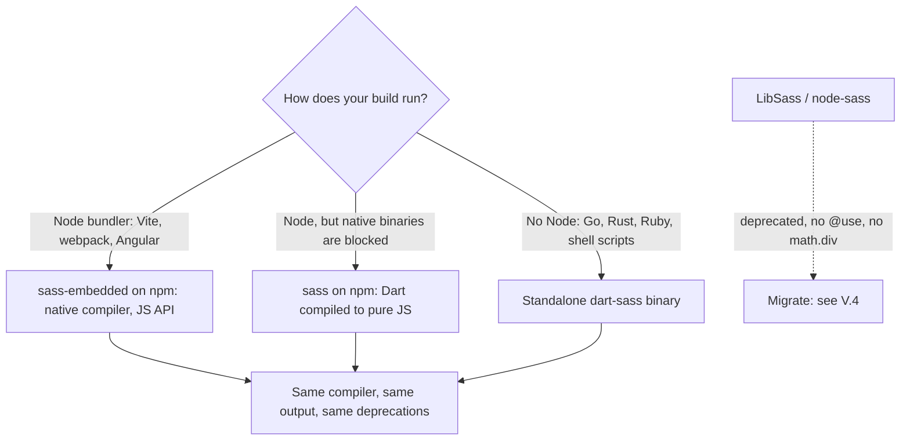

| Package | What it is | When to pick it |
| --- | --- | --- |
| `sass` | Dart Sass compiled to JavaScript | Simplest install, works anywhere Node runs; the starter uses it so tests run identically on every OS. |
| `sass-embedded` | A JS wrapper that drives a native Dart Sass binary over the embedded protocol | Large projects in bundlers: same API as `sass`, noticeably faster compiles. |
| Standalone binary | Native executable from the Dart Sass GitHub releases | CI images without Node, or non-JS build tools. |

`node-sass` and LibSass are deprecated. They never implemented the module system, so code written for them uses `@import` and `/` division, and they stopped receiving new CSS syntax years ago.

### 1.3 Installation & First Compile

Install Dart Sass as a dev dependency so every developer and CI job uses the version in `package-lock.json`:

```bash
# Inside the starter project
npm install           # installs sass, sass-true and stylelint from package-lock.json
npx sass --version    # prints the locked version, for example 1.107.1

# A brand-new project
npm init -y
npm install --save-dev sass

# Or install the standalone binary globally (no Node project needed)
brew install sass/sass/sass        # macOS / Linux with Homebrew
choco install sass                 # Windows with Chocolatey
```

Compile one file, then a whole directory, then watch:

```bash
# One input, one output
npx sass src/scss/main.scss public/css/main.css

# Many-to-many: every non-partial .scss file in src/scss becomes a .css file
npx sass src/scss:public/css

# Recompile on every save, with source maps that embed the original SCSS
npx sass --watch --embed-sources src/scss/main.scss public/css/main.css

# Production: minified, no source map, fail on anything Dart Sass 2.0.0 removes
npx sass --no-source-map --style=compressed --fatal-deprecation=dart-sass-2 \
  src/scss/main.scss public/css/main.css

# Try expressions interactively (type the lines after >>)
npx sass --interactive
>> @use "sass:math"
>> math.div(24px, 16px) * 1rem
1.5rem
```

The starter wraps these commands in npm scripts:

| Script | Command | Use |
| --- | --- | --- |
| `npm run dev` | `sass --watch --embed-sources src/scss/main.scss public/css/main.css` | Edit SCSS, refresh `public/index.html`. |
| `npm run build` | `sass --no-source-map --style=compressed --fatal-deprecation=dart-sass-2 ...` | Production CSS; CI and the Docker image run it. |
| `npm run lint` | `stylelint "src/scss/**/*.scss"` | Enforces naming, nesting depth and ordering rules. |
| `npm test` | `node --test tests/sass.test.js` | Runs the SCSS test suites in `tests/*.test.scss`. |

Files whose names start with `_` are **partials**. The many-to-many mode skips them, because they are only meant to be loaded by other files. That is why `src/scss:public/css` produces `main.css` and nothing for `_variables.scss`.

### 1.4 Line-by-Line Breakdown of the Starter Project

The repository root is a small design system. It compiles to one stylesheet that `public/index.html` loads, and an nginx image serves both.

```text
learn-scss/
├── src/scss/
│   ├── abstracts/          tokens, functions, mixins: emit no CSS on their own
│   │   ├── _variables.scss $colors, $spacing, $breakpoints, all !default
│   │   ├── _functions.scss rem(), palette(), space(), contrast-ratio(), on-color(), shade(), fluid()
│   │   ├── _mixins.scss    respond-to(), flex-center(), focus-ring(), text-truncate()
│   │   └── _index.scss     @forward barrel for the three files above
│   ├── base/               _root.scss (custom properties), _reset.scss, _typography.scss
│   ├── layout/             _grid.scss
│   ├── components/         _buttons.scss, _cards.scss
│   └── main.scss           entry point: load order only
├── tests/                  *.test.scss (sass-true) and the sass.test.js runner
├── exercises/              solutions to each stage's hands-on exercise, also tested
├── examples/m1-theming/    the theme engine from masterclass M1, with its test
├── public/index.html       demo page; npm run build writes public/css/main.css
├── docker/nginx.conf       serves public/ and answers /health
└── Dockerfile              node:24-alpine build stage, nginx-unprivileged runtime
```

The entry point contains nothing but `@use` rules:

```scss
// src/scss/main.scss
@use "base/root";
@use "base/reset";
@use "base/typography";
@use "layout/grid";
@use "components/buttons";
@use "components/cards";
```

| Line / API | Role | What happens at compile time |
| :--- | :--- | :--- |
| `@use "base/root"` | Loads `base/_root.scss` | Sass finds the partial (the `_` and `.scss` are implied), runs it once, and appends its CSS: the `:root { --color-*: ... }` block. |
| `@use "base/reset"` | Element defaults | Its own `@use "../abstracts" as a` loads the abstracts module. This is the first load, so the module is evaluated here. |
| `@use "base/typography"` | Headings and text | Also uses abstracts. Sass reuses the already-loaded module instead of evaluating it again, so no CSS is duplicated. |
| `@use "layout/grid"` | `.container`, `.grid` | Emits rules with media queries from `respond-to()`. |
| `@use "components/buttons"` | `.btn` and variants | Generates one modifier per entry in `$variants` with `@each`. |
| `@use "components/cards"` | `.card` block | Emits BEM element and modifier rules from `&__` and `&--` nesting. |
| Order of the lines | Cascade order | CSS appears in the output in the order modules are first loaded, so base rules precede components and components win ties. |

One component, read line by line:

```scss
// src/scss/components/_buttons.scss
@use "../abstracts" as a;

$variants: (
  "primary": a.palette("primary"),
  "accent": a.palette("accent"),
  "warning": a.palette("warning"),
  "danger": a.palette("danger"),
);

.btn {
  @include a.flex-center(inline-flex);

  gap: a.space(2);
  padding: a.space(2) a.space(4);
  font-size: a.rem(14px);
  font-weight: 600;
  border: 1px solid transparent;
  border-radius: a.rem(8px);
  cursor: pointer;
  transition: background-color 0.15s ease-in-out;

  // Nested rules come after the declarations, so .btn compiles to one rule.
  @include a.focus-ring(a.palette("accent"));

  @each $name, $background in $variants {
    &--#{$name} {
      color: a.on-color($background);
      background-color: $background;

      &:hover {
        background-color: a.shade($background, 8%);
      }
    }
  }
}
```

| Line / API | Role | Result in `main.css` |
| :--- | :--- | :--- |
| `@use "../abstracts" as a` | Loads the barrel under the short namespace `a` | Members are reached as `a.palette()`, `a.$colors`. |
| `$variants: (...)` | A map local to this module | Not emitted; drives the loop. |
| `@include a.flex-center(inline-flex)` | Mixin with an argument | `display: inline-flex; align-items: center; justify-content: center;` |
| `a.space(2)` | Token lookup | `0.5rem`. A typo such as `a.space(5)` stops the build with the list of valid steps. |
| `a.rem(14px)` | Unit conversion | `0.875rem`. |
| `@include a.focus-ring(...)` | Mixin that emits a nested rule | `.btn:focus-visible { outline: 2px solid #06b6d4; outline-offset: 2px; }` |
| `@each $name, $background in $variants` | Loop over map entries | Four modifier rules. |
| `&--#{$name}` | Parent selector plus interpolated suffix | `.btn--primary`, `.btn--accent`, ... |
| `a.on-color($background)` | Contrast-aware text colour | `#fff` on primary and danger, `#0f172a` on accent and warning. |
| `a.shade($background, 8%)` | OKLCH darkening plus gamut mapping | An `rgb(...)` colour about 8% darker in perceived lightness. |

### 1.5 Nesting and the Parent Selector &

Nesting writes child selectors inside their parent. Sass joins the selectors with a space unless you use `&`, which stands for the full parent selector at that point.

```scss
.card {
  padding: 1.5rem;

  // descendant: .card .icon
  .icon { width: 1rem; }

  // pseudo-class on the parent: .card:hover
  &:hover { border-color: #4f46e5; }

  // suffix (Sass only, not native CSS): .card__title, .card--highlight
  &__title { margin: 0; }
  &--highlight { border-color: #06b6d4; }

  // parent in a later position: .theme-dark .card
  .theme-dark & { background: #0f172a; }

  // parent used twice: .card:not(.card--highlight)
  &:not(&--highlight) { opacity: 0.9; }

  // child combinator at the start: .card > p
  > p { margin-block: 0; }
}
```

Compiled with `--style=expanded`, Sass writes each rule separately:

```css
.card { padding: 1.5rem; }
.card .icon { width: 1rem; }
.card:hover { border-color: #4f46e5; }
.card__title { margin: 0; }
.card--highlight { border-color: #06b6d4; }
.theme-dark .card { background: #0f172a; }
.card:not(.card--highlight) { opacity: 0.9; }
.card > p { margin-block: 0; }
```

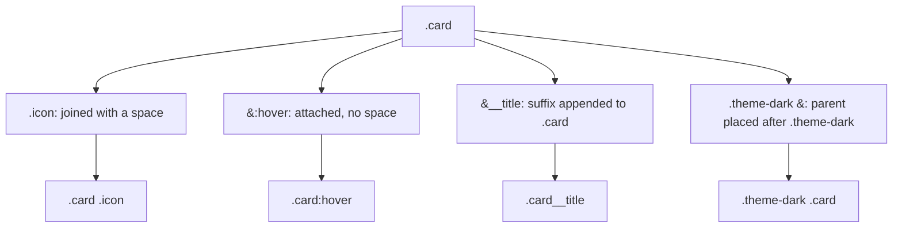

**Declaration order.** Since Dart Sass 1.92.0, declarations are emitted where you write them. A declaration after a nested rule therefore lands in a second copy of the parent rule:

```scss
.btn {
  color: white;
  &:hover { color: #e0e7ff; }
  background: #4f46e5;      // emitted after .btn:hover, in a new .btn block
}
```

```css
.btn { color: white; }
.btn:hover { color: #e0e7ff; }
.btn { background: #4f46e5; }
```

The output is correct, but it is bigger and harder to read in DevTools. Put all declarations first and nested rules after them; a mixin that emits a nested rule (like `focus-ring()` in the starter) counts as a nested rule. The `order/order` rule from the `stylelint-order` plugin can enforce this in CI.

**Sass nesting versus native CSS nesting.** If you author `.css` files with native nesting, the browser resolves it. In `.scss`, Sass flattens it at build time:

| Behaviour | Sass (`.scss`) | Native CSS nesting |
| --- | --- | --- |
| `&__title` suffix | Builds `.card__title` | Invalid: `&` cannot be glued to an identifier |
| `.theme-dark &` | Supported | Supported |
| Output | Flat selectors | Nested rules, resolved by the browser |
| Parent list with mixed weight: `.a, #b { .c {} }` | `.a .c, #b .c`: each selector keeps its own specificity | Behaves like `:is(.a, #b) .c`: both get the ID's specificity |

### 1.6 Variables, Scope & Flags

A Sass variable holds a value at compile time. It is gone from the output; only the values it produced remain.

```scss
$brand: #4f46e5;               // module-level (top of the file)
$radius: 8px !default;         // assigned only if $radius is unset or null

.button {
  $pad: 0.5rem;                // local to this block
  padding: $pad calc($pad * 2);
  border-radius: $radius;
  background: $brand;
}

// .other { padding: $pad; }  // Error: Undefined variable.
```

Scope rules, verified against the current compiler:

```scss
$c: red;

.a {
  $c: blue;        // a new local $c that shadows the module-level one
  color: $c;       // blue
}

.b {
  color: $c;       // red: the shadowing did not leak out of .a
}

$compact: false;

@if true {
  $compact: true;  // flow-control blocks assign to an existing outer variable
}

.c {
  gap: if(sass($compact): 4px; else: 8px);  // 4px
}
```

| Flag | Meaning | Typical use |
| --- | --- | --- |
| `!default` | Assign only if the variable is undefined or `null` | Library settings that consumers configure with `@use ... with` ([2.6](#26-configuring-modules-with-with-and-default)). |
| `!global` | Assign to the module-level variable from inside a block | Rare. Since 1.17.2 it may not create a new variable (`new-global` deprecation, an error in 2.0.0). Declare `$x: null;` at the top first. |

Sass variables and CSS custom properties are different tools:

| | `$variable` | `--custom-property` |
| --- | --- | --- |
| Resolved | At build time, once | In the browser, per element |
| Follows the cascade and inheritance | No | Yes |
| Can change with media queries, `:hover`, JavaScript | No | Yes |
| Can be used in selectors and media query conditions | Yes | No (not in media queries) |
| Validated by the build | Yes, with `@error` | No; an invalid value fails silently at computed-value time |

The starter uses both: Sass maps hold the values and validate them, and `base/_root.scss` publishes them as custom properties for runtime use.

### 1.7 Interpolation, Comments and Placeholders

Interpolation, `#{...}`, inserts the result of an expression into places where Sass would otherwise read literal text: selectors, property names, at-rule preludes and strings.

```scss
$side: top;
$prop: margin;
$block: "card";

.#{$block}-#{$side} {               // .card-top
  #{$prop}-#{$side}: 1rem;          // margin-top: 1rem
  content: "#{$block} header";      // "card header"
}
```

Inside `calc()`, `clamp()`, `min()` and `max()`, you do **not** need interpolation. Dart Sass treats these as first-class calculations: it simplifies what it can and keeps the rest.

```scss
$gutter: 640px;

.c {
  width: calc(100% - $gutter);      // calc(100% - 640px)
  height: calc(10px + 6px);         // 16px: fully simplified at build time
}
```

Wrapping the variable in `#{}` (`calc(100% - #{$gutter})`) still works, but it turns the expression into an opaque string, so Sass can no longer simplify it or check its units. Use bare variables.

Comments come in four kinds:

| Syntax | In the output? | Use |
| --- | --- | --- |
| `// note` | Never | Everyday comments. |
| `/* note */` | In expanded output; removed by `--style=compressed` | Comments you want in development CSS. |
| `/*! licence */` | Always, even compressed | Licence headers. |
| `/// @param ...` | Never | SassDoc documentation for functions and mixins, as in `_functions.scss`. |

Placeholder selectors start with `%`. They emit nothing unless something `@extend`s them, which makes them the safe way to use `@extend` ([4.6](#4-stage-4-mixins-content-blocks--control-flow) compares `@extend` with mixins).

```scss
%visually-hidden {
  position: absolute;
  width: 1px;
  height: 1px;
  overflow: hidden;
  clip-path: inset(50%);
  white-space: nowrap;
}

.skip-link:not(:focus) { @extend %visually-hidden; }
.sr-only { @extend %visually-hidden; }
// Output: .skip-link:not(:focus), .sr-only { position: absolute; ... }
```

### 1.8 Output Styles, Source Maps & Deprecation Controls

`--style=expanded` (the default) writes one declaration per line. `--style=compressed` removes whitespace and comments and shortens values (`0.5rem` becomes `.5rem`, `transparent` may become `rgba(0,0,0,0)`). There are no other styles in Dart Sass; `nested` and `compact` were LibSass and Ruby Sass options.

A source map is a JSON file that maps each position in the CSS back to the `.scss` line that produced it. DevTools reads it and shows `_buttons.scss:24` instead of `main.css:1`. Use `--embed-sources` in development so the map works without serving `src/`. Skip maps in production unless your error tracking needs them, because they expose your source.

Warnings and deprecations have flags of their own:

| Flag | Effect |
| --- | --- |
| `--quiet-deps` | Hide warnings from files loaded through load paths or `pkg:` (third-party code you cannot fix). |
| `--silence-deprecation=import` | Hide one named deprecation while you migrate. |
| `--fatal-deprecation=dart-sass-2` | Turn every deprecation that 2.0.0 will remove into an error. |
| `--future-deprecation=...` | Opt in early to deprecations not yet active by default. |
| `--verbose` | Print every occurrence, not just the first few of each kind. |
| `--error-css` / `--no-error-css` | Whether a failed compile writes a CSS file that shows the error on the page. On by default when writing to a file. |

Every deprecation warning carries an ID in brackets. The message for slash division, for example, starts with `DEPRECATION WARNING [slash-div]:` and suggests `math.div(100px, 2)`. That ID is what the flags above accept.

### 1.9 Pitfalls

| Pitfall | Symptom | Fix |
| --- | --- | --- |
| Installing `node-sass` from an old tutorial | npm prints "Node Sass is no longer supported. Please use `sass` or `sass-embedded` instead." and native builds fail on new Node versions | `npm uninstall node-sass && npm install -D sass`, then follow [V.4](#v4-migration-guide-libsass-or-older-dart-sass--1107). |
| Using a variable outside the block that declared it | `Error: Undefined variable.` pointing at `$pad` | Move the declaration to the top of the module, or pass the value as a mixin argument. |
| Declarations after nested rules | The same selector appears twice in the output | Write all declarations before nested rules and before `@include`s that emit nested rules. |
| `!global` to create a variable | `DEPRECATION WARNING [new-global]: As of Dart Sass 2.0.0, !global assignments won't be able to declare new variables.` | Declare `$x: null;` at the root, then assign with `!global`, or better, return a value from a function. |
| Interpolating inside `calc()` | Output keeps `calc(10px + 6px)` unsimplified and unit errors go unnoticed | Write `calc($a + $b)` without `#{}`. |
| Expecting `&-suffix` to work in a `.css` file | The browser drops the rule | Suffixes only work in `.scss`; in native CSS write the full class. |
| Slash division `(100px / 2)` | `DEPRECATION WARNING [slash-div]: Using / for division outside of calc() is deprecated and will be removed in Dart Sass 2.0.0.` | `math.div(100px, 2)` or `calc(100px / 2)`; `sass-migrator division` fixes a codebase. |
| Compiling partials directly | `npx sass src/scss:out` produces no file for `_buttons.scss` | Intended: partials are loaded by other files. Compile the entry point. |

### 1.10 Best Practices

- Pin Dart Sass in `devDependencies` and commit the lockfile: every machine then produces byte-identical CSS.
- Use `sass-embedded` in large bundler builds: it runs the native compiler with the same API and output.
- Keep `main.scss` to `@use` lines only: load order is the cascade order, and nothing else should be hidden there.
- Write declarations first, nested rules second: the output stays one block per selector.
- Nest at most three levels: deeper nesting produces long, high-specificity selectors that are hard to override.
- Prefer `$variables` for build-time values and custom properties for anything that changes at runtime: each tool does one of these jobs well.
- Run production builds with `--fatal-deprecation=dart-sass-2`: you find code that will break on the next major version while the fix is small.
- Use `///` comments on public functions and mixins: SassDoc and editors pick them up, and they never reach the CSS.

### 1.11 Hands-on Exercise

Add a `.badge` component to the starter.

1. Create `src/scss/components/_badges.scss` that uses `../abstracts` as `a`, and add `@use "components/badges";` to `main.scss` after the buttons.
2. Write a `.badge` block with `padding: a.space(1) a.space(2)`, `font-size: a.rem(12px)` and `border-radius: 999px`, plus a `&--warning` modifier with `color: a.on-color(a.palette("warning"))` and `background-color: a.palette("warning")`.
3. Run `npm run dev` and add `<span class="badge badge--warning">Beta</span>` to `public/index.html`.

Expected output in `public/css/main.css` (expanded):

```css
.badge {
  padding: 0.25rem 0.5rem;
  font-size: 0.75rem;
  border-radius: 999px;
}
.badge--warning {
  color: #0f172a;
  background-color: #facc15;
}
```

The solution is `exercises/stage-1/_badges.scss`, and `npm test` checks that it compiles to exactly these rules. The patterns it copies are `src/scss/components/_cards.scss` (block and modifiers) and `_buttons.scss` (computed text colour).

[Back to top ⤴️](#-table-of-contents)

---

## 2. Stage 2: The Module System with @use and @forward

The module system decides which file can see which variable, function and mixin, how often a file's CSS is emitted, and how a library is configured. It replaced `@import`, which is deprecated and scheduled for removal in Dart Sass 3.0.0. After this stage you can split a stylesheet into encapsulated modules, build an `_index.scss` barrel, configure a library with `with`, and read any module error message the compiler gives you.

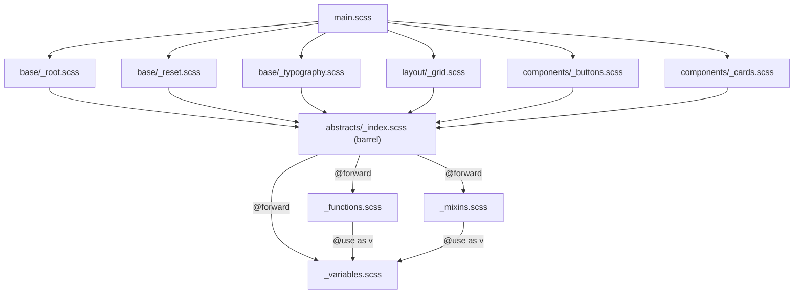

Six modules depend on the abstracts barrel, yet `_variables.scss` is evaluated exactly once per compilation. That single-evaluation guarantee is the core difference from `@import`.

### 2.1 Why @import Was Deprecated

`@import "file"` pasted the target into the current file, as if you had copied its text. Three problems followed from that design:

1. **Everything was global.** Every variable, mixin and function from every imported file landed in one shared namespace. Two libraries that both defined `$primary` or `@mixin button` silently overwrote each other, and the winner depended on import order.
2. **Files ran once per import.** If five partials imported `_buttons.scss`, its CSS was emitted five times. Teams worked around this with "import once" mixins and strict conventions.
3. **No encapsulation or traceability.** Helper variables could not be private, and finding where `$gutter` came from meant searching the whole tree.

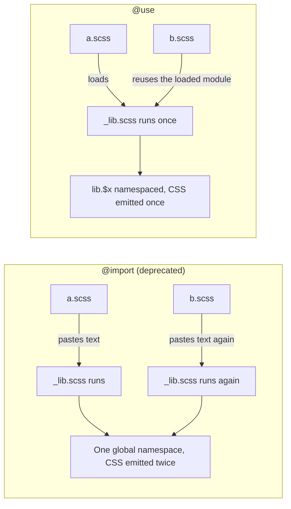

The module system shipped in Dart Sass 1.23.0 (October 2019). `@import` and the global built-in functions were formally deprecated in 1.80.0 (October 2024), with removal planned for Dart Sass 3.0.0. Every `@import` now prints:

```text
DEPRECATION WARNING [import]: Sass @import rules are deprecated and will be removed in Dart Sass 3.0.0.
```

Plain CSS imports are not affected. `@import url("theme.css");`, an import with a media query, or one whose URL starts with `http://` or ends in `.css` is passed through to the output unchanged, because it is a CSS feature, not a Sass one.

### 2.2 Loading Modules with @use

`@use "path"` loads a module and makes its public members available under a namespace, which defaults to the last component of the URL without extension or leading underscore.

```scss
// _colors.scss
$primary: #6366f1;
$surface: #ffffff;
$-dark-secret: #0f172a;           // private: the name starts with - (or _)

// main.scss
@use "colors";

.btn-primary {
  background-color: colors.$primary;   // namespace.$variable
  color: colors.$surface;
  // background: colors.$-dark-secret;
  // Error: Private members can't be accessed from outside their modules.
}
```

The rules `@use` follows:

| Rule | Consequence |
| --- | --- |
| `@use` must come before any other rule except `@forward` and variable declarations | Writing it after a style rule fails with `@use rules must be written before any other rules.` |
| A module is evaluated once per compilation, however many files load it | Its CSS appears once, at the position of the first load. |
| Members are reached through the namespace | `colors.$primary`, `colors.mix()`, `@include colors.swatch;` |
| Members are visible only in the file that wrote the `@use` | A file that `@use`s `main.scss` does not see `colors`. Use `@forward` to re-export. |
| Another module's variable can be reassigned with `colors.$primary: red;` | The change is visible to every file that uses the module, but only for code evaluated after the assignment. That order dependence is why `with` is the better tool. |

### 2.3 Namespaces: Default, Custom and Global

```scss
// Default namespace: the file name
@use "src/abstracts/typography";       // typography.$scale

// Custom namespace: shorter, or to resolve a clash
@use "src/abstracts/typography" as type;   // type.$scale

// No namespace: members land in this file's scope
@use "src/abstracts/mixins" as *;      // @include respond-to(md);
```

Two modules may not share a namespace in one file:

```scss
@use "colors";
@use "brand/colors";   // Error: There's already a module with namespace "colors".
@use "brand/colors" as brand;   // fine
```

`as *` is convenient for a project's own abstracts but hides where a name comes from, and two `as *` modules that define the same member make every use of that member ambiguous (`This variable is available from multiple global modules.`). The starter uses a short explicit namespace, `as a`, everywhere: it costs two characters per call and keeps every lookup traceable.

| Style | Example | Pros | Cons |
| --- | --- | --- | --- |
| Default namespace | `@use "tokens";` then `tokens.$space` | Self-documenting | Long calls in token-heavy files |
| Short alias | `@use "abstracts" as a;` then `a.space(4)` | Short and still traceable | Readers must learn the alias |
| Global | `@use "abstracts" as *;` then `space(4)` | Reads like the old `@import` | Clashes with other `as *` modules and with CSS function names |

### 2.4 How Sass Resolves a URL

A `@use` URL is always written with forward slashes and without the leading underscore or extension. For `@use "components/buttons"` Sass tries, relative to the current file first and then each load path:

1. `components/buttons.scss`, `components/buttons.sass`, `components/buttons.css`
2. `components/_buttons.scss`, `components/_buttons.sass`, `components/_buttons.css`
3. If `components/buttons` is a directory: `components/buttons/_index.scss` (or `index.scss`, `.sass`, `.css`)

If two candidates match, for example both `_buttons.scss` and `buttons.scss`, compilation fails as ambiguous.

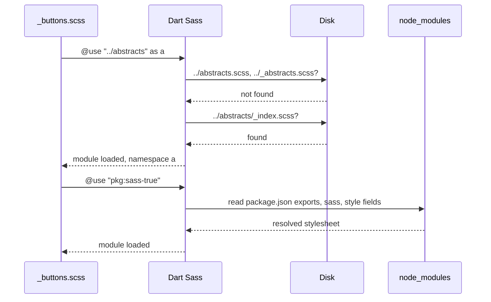

Ways to point Sass at shared code:

| Mechanism | Example | Use |
| --- | --- | --- |
| Relative URL | `@use "../abstracts" as a;` | Code inside the project. |
| Load path | `sass -I node_modules/design-system/scss src:out`, then `@use "tokens";` | A shared folder of SCSS. Can hide which file wins if several paths contain the same name. |
| `pkg:` URL (Dart Sass 1.71.0+) | `sass --pkg-importer=node ...`, then `@use "pkg:bootstrap";` | npm packages. Sass follows the package's `exports`, `sass` or `style` field the way Node resolves modules. |
| Custom importer (JS API) | `sass.compile(path, { importers: [...] })` | Monorepo aliases, generated files, virtual modules. |

`pkg:` URLs replaced the old `~package` convention that webpack's `sass-loader` invented. The starter's test runner relies on the same machinery: sass-true registers a Node package importer, so `@use "true"` resolves to the installed library.

### 2.5 Re-exporting with @forward

`@forward` makes another module's public members available to whoever `@use`s the current file. It does **not** make them available inside the current file; add a separate `@use` for that.

```scss
// src/scss/abstracts/_index.scss (the starter's barrel)
@forward "variables";
@forward "functions";
@forward "mixins";
```

Consumers write one line, `@use "../abstracts" as a;`, and get `a.$colors`, `a.rem()` and `@include a.respond-to()`. When a file later moves from `_functions.scss` to `_color.scss`, only the barrel changes.

`@forward` can filter and rename:

```scss
// _index.scss of a published design system
@forward "variables" show $brand-primary, $brand-secondary;   // only these two
@forward "mixins" hide -internal-reset;                       // all except this
@forward "functions" as fn-*;                                 // fn-rem(), fn-palette()
```

Prefixing helps when a library forwards several modules whose member names would collide, or when consumers load it with `as *`. A forwarded and prefixed member keeps its prefix for consumers: `@use "lib";` then `lib.fn-rem(24px)`.

Using and forwarding the same module in one file is common in barrels that also compute something:

```scss
// _theme.scss
@forward "tokens";                 // re-export tokens to consumers
@use "tokens";                     // and use them here
@use "sass:map";

$surface-strong: map.get(tokens.$colors, "surface");
```

Write the `@forward` before the `@use` of the same module. If a consumer configured this file, the `@forward` passes that configuration on, and the module must not be loaded unconfigured first. Both rules go before any style rule.

### 2.6 Configuring Modules with with and !default

A module exposes settings by declaring variables with `!default`. The first file to load it can override them with `with`:

```scss
// _library.scss
$theme: "light" !default;
$radius: 4px !default;

.panel {
  border-radius: $radius;
  @if $theme == "dark" { background: #0f172a; }
}

// main.scss
@use "library" with (
  $theme: "dark",
  $radius: 8px
);
```

The rules, each with the error the compiler prints when you break it:

| Rule | Error when broken |
| --- | --- |
| Only `!default` variables can be configured | `This variable was not declared with !default in the @used module.` |
| A module can be configured only on its first load in a compilation | `This module was already loaded, so it can't be configured using "with".` |
| `!default` is not allowed inside `@use ... with` | `expected ")".` (Only `@forward ... with` accepts `!default`.) |
| Private `$-variables` should not be configured | Deprecated since 1.92.0; make the setting public. |

Configuration flows through `@forward`. The starter declares `$root-font-size: 16px !default;` in `_variables.scss`, forwards it from the barrel, and `tests/config.test.scss` configures it through the barrel:

```scss
// tests/config.test.scss
@use "true" as *;
@use "../src/scss/abstracts" as a with ($root-font-size: 20px);

@include describe("@use ... with") {
  @include it("reconfigures rem() for the whole compilation") {
    @include assert-equal(a.rem(20px), 1rem);
    @include assert-equal(a.$root-font-size, 20px);
  }
}
```

A barrel can set its own defaults on behalf of consumers with `@forward ... with` and `!default`, so that a consumer's configuration still wins:

```scss
// brand/_index.scss: a brand layer over a generic library
@forward "library" with (
  $radius: 12px !default    // brand default, consumers may still override it
);
```

Because configuration only works on the first load, the configuring `@use` must run before any other file loads the module. In an application this means configuring in `main.scss` on its first line. In a library, document the settings and never load your own configurable module from another module that might be evaluated first.

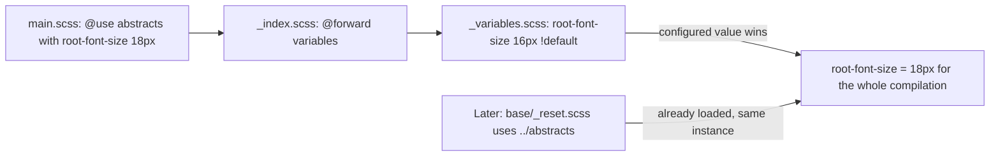

### 2.7 Private Members & Encapsulation

A member whose name starts with `-` or `_` is private to its module. Sass treats `-` and `_` as the same character in identifiers, so `$-threshold` and `$_threshold` are one variable.

```scss
// src/scss/abstracts/_functions.scss
$-srgb-linear-threshold: 0.04045;          // private constant

@function -to-linear($channel) {            // private helper
  $c: math.div($channel, 255);
  @if $c <= $-srgb-linear-threshold {
    @return math.div($c, 12.92);
  }
  @return math.pow(math.div($c + 0.055, 1.055), 2.4);
}

@function luminance($color) { ... }         // public API that calls the helper
```

From another module, `a.$-srgb-linear-threshold` or `a.-to-linear(10)` fails with `Private members can't be accessed from outside their modules.` That lets you refactor helpers freely: nothing outside the file can depend on them.

To inspect a module's public surface while debugging, use `sass:meta`:

```scss
@use "sass:meta";
@use "../abstracts" as a;

@debug meta.module-variables("a");   // ("root-font-size": 16px, "colors": (...), ...)
@debug meta.module-functions("a");   // ("rem": get-function("rem"), "palette": ..., ...)
```

### 2.8 Built-in Modules and meta.load-css()

Sass's standard library is split into modules that you load with `sass:` URLs. Each must be `@use`d in every file that calls it.

| Module | Common members | Replaces the global |
| --- | --- | --- |
| `sass:math` | `math.div()`, `math.round()`, `math.clamp()`, `math.pow()`, `math.unit()`, `math.$pi` | `/` division, `round()`, `percentage()` |
| `sass:color` | `color.adjust()`, `color.scale()`, `color.mix()`, `color.channel()`, `color.to-space()`, `color.to-gamut()` | `darken()`, `lighten()`, `mix()`, `red()` |
| `sass:map` | `map.get()`, `map.set()`, `map.merge()`, `map.deep-merge()`, `map.has-key()`, `map.keys()` | `map-get()`, `map-merge()` |
| `sass:list` | `list.nth()`, `list.append()`, `list.join()`, `list.index()`, `list.length()`, `list.slash()` | `nth()`, `append()`, `length()` |
| `sass:string` | `string.index()`, `string.slice()`, `string.unquote()`, `string.to-upper-case()` | `str-index()`, `unquote()` |
| `sass:meta` | `meta.type-of()`, `meta.inspect()`, `meta.load-css()`, `meta.get-function()`, `meta.module-variables()` | `type-of()`, `inspect()` |
| `sass:selector` | `selector.nest()`, `selector.append()`, `selector.unify()` | `selector-nest()` |

`meta.load-css()` is the one way to load a module's CSS conditionally or inside a selector, because `@use` must be at the top of a file:

```scss
// _theme.scss
$tone: red !default;
.themed { color: $tone; }

// main.scss
@use "sass:meta";

.dark {
  @include meta.load-css("theme", $with: ("tone": black));
}
```

```css
.dark .themed {
  color: black;
}
```

`meta.load-css()` emits CSS only; it does not make the module's members available. If the same module was already loaded elsewhere, it cannot be configured again: `_theme.scss was already loaded, so it can't be configured using "with".` [M2](#m2-masterclass-cascade-layers--specificity-control) uses it to wrap vendor CSS in a cascade layer.

### 2.9 Pitfalls

| Pitfall | Symptom | Fix |
| --- | --- | --- |
| `@use` after a style rule | `Error: @use rules must be written before any other rules.` | Move every `@use` and `@forward` to the top of the file. |
| Expecting `@use` to re-export | A file that uses `main.scss` gets `Undefined variable.` for `colors.$primary` | Add `@forward "colors";` to the file that should re-export. |
| Configuring a module that something else loaded first | `This module was already loaded, so it can't be configured using "with".` | Put the configuring `@use` on the first line of the entry point, before modules that depend on it. |
| Configuring a non-default variable | `This variable was not declared with !default in the @used module.` | Add `!default` in the library, or stop configuring that variable. |
| `!default` inside `@use ... with` | `Error: expected ")".` | Remove it; only `@forward ... with` accepts `!default`. |
| Two modules with the same default namespace | `There's already a module with namespace "colors".` | Give one an alias: `@use "brand/colors" as brand;`. |
| Two `as *` modules defining the same name | `This variable is available from multiple global modules.` | Use namespaces, or `@forward ... hide` in a barrel. |
| Accessing a private helper | `Private members can't be accessed from outside their modules.` | Expose a public function, or keep the call inside the module. |
| Both `_buttons.scss` and `buttons.scss` exist | `It's not clear which file to import.` | Delete or rename one. |
| Global built-ins left after migrating imports | `DEPRECATION WARNING [global-builtin]: Global built-in functions are deprecated and will be removed in Dart Sass 3.0.0.` | `@use "sass:color";` and call `color.adjust()`, or run `sass-migrator module`. |

### 2.10 Best Practices

- One barrel (`_index.scss`) per folder of shared code: consumers write one `@use` and refactors stay local.
- Load abstracts with a short alias such as `as a` rather than `as *`: every call stays traceable and cannot clash.
- Mark every setting `!default` and document it: that is the module's public configuration API.
- Configure on the first line of the entry point: later loads reuse the configured instance.
- Prefix private helpers with `-`: refactoring them can never break another file.
- Keep modules that only define tokens, functions and mixins free of CSS output: they can then be loaded from anywhere without side effects.
- Use `pkg:` URLs for npm packages: resolution follows `package.json` instead of a fragile `node_modules/...` path.
- Turn on `--fatal-deprecation=import` once migrated: nobody can add an `@import` back.

### 2.11 Hands-on Exercise

Make the starter's palette configurable for a second brand without touching `src/`.

1. Create `exercises/stage-2/brand.scss` that loads the starter's abstracts with a new primary colour by configuring the whole `$colors` map (copy the map and change `"primary"` to `#be185d`).
2. In the same file, load `meta.load-css()` for `../../src/scss/components/buttons` inside a `.brand-b` selector.
3. Compile it with `npx sass --no-source-map exercises/stage-2/brand.scss`.

Expected output starts with:

```css
.brand-b .btn {
  display: inline-flex;
```

and contains `.brand-b .btn--primary` with `background-color: #be185d` and `color: #fff`, because `on-color()` recomputes the text colour for the new background. The solution is in `exercises/stage-2/brand.scss`. Notice that configuring `$colors` replaces the whole map: a key you leave out disappears, and `palette()` reports it as unknown. [M1](#m1-masterclass-design-tokens-to-runtime-theming) shows how to merge partial overrides with `map.deep-merge()` instead.

[Back to top ⤴️](#-table-of-contents)

---

## 3. Stage 3: Data Types, Maps, Lists, Functions & Math

Sass is a small programming language whose values happen to be CSS values. This stage covers every value type, unit arithmetic, lists and nested maps, writing functions that validate their input, colour maths in modern colour spaces, and testing all of it. It assumes Stages 1 and 2. Afterwards you can build token lookups, unit converters and contrast checks that stop the build when someone passes a wrong value, and prove they work with unit tests.

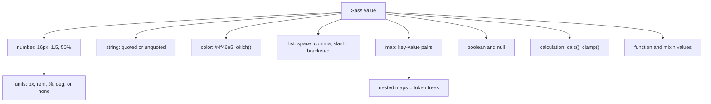

### 3.1 Value Types and meta.type-of()

Every Sass expression evaluates to one of these types. `meta.type-of()` returns the type name as a string, which is how functions validate their arguments.

| Type | Examples | `meta.type-of()` | Notes |
| --- | --- | --- | --- |
| Number | `16px`, `1.5`, `50%`, `90deg` | `number` | Carries units; maths checks them. |
| String | `"Inter"`, `sans-serif`, `bold` | `string` | Quoted and unquoted are equal when their text is equal. |
| Color | `#4f46e5`, `rgb(79 70 229)`, `oklch(60% 0.15 250)` | `color` | Remembers its colour space since 1.79.0. |
| List | `1px 2px`, `a, b`, `[full-start]` | `list` | Space-, comma- or slash-separated, optionally bracketed. |
| Map | `("sm": 640px, "md": 768px)` | `map` | Ordered; keys can be any value. |
| Boolean | `true`, `false` | `bool` | Only `false` and `null` are falsy. |
| Null | `null` | `null` | A declaration whose value is `null` is left out of the output. |
| Calculation | `calc(100% - 2rem)`, `clamp(1rem, 2vw, 2rem)` | `calculation` | Kept as CSS when it cannot be simplified. |
| Function | `meta.get-function("rem")` | `function` | Called with `meta.call()`. |
| Mixin | `meta.get-mixin("respond-to")` | `mixin` | Included with `meta.apply()`. |

Two behaviours catch people out. First, `0` and `""` are **truthy**: only `false` and `null` make `@if` skip. Second, a `null` property value removes the declaration, which is useful for optional arguments and dangerous for typos:

```scss
@use "sass:map";

$spacing: ("sm": 4px);

.x {
  margin: map.get($spacing, "md");   // null: the declaration silently disappears
  padding: 1px;
}
// Output: .x { padding: 1px; }
```

That silent disappearance is why the starter wraps every map lookup in a function that calls `@error` for unknown keys ([3.6](#36-writing-functions-with-function-and-error)).

### 3.2 Numbers, Units & sass:math

Sass numbers keep their units through arithmetic and refuse to combine incompatible ones:

```scss
@use "sass:math";

@debug 10px + 6px;                // 16px
@debug 1in + 6px;                 // 1.0625in: compatible absolute units convert
@debug math.div(10px, 4);         // 2.5px
@debug math.div(10px, 2px);       // 5: px cancels out
@debug math.percentage(0.25);     // 25%
@debug math.round(2.5);           // 3
@debug math.clamp(0, 12, 10);     // 10
@debug math.unit(16px);           // "px"
@debug math.is-unitless(2);       // true
@debug math.compatible(1px, 1in); // true
// @debug 1px + 1em;             // Error: 1px and 1em have incompatible units.
```

**Division.** `/` is a separator in CSS (`font: 16px/1.5`, `grid-row: 1 / 3`, `aspect-ratio: 16 / 9`), so Dart Sass deprecated it as division in 1.33.0. Use `math.div()`, or `calc()` when the browser should do it:

```scss
@use "sass:math";

.a {
  width: math.div(100%, 3);         // 33.3333333333%
  font: 16px/1.5 sans-serif;        // left alone: a CSS separator
  height: calc(100vh / 3);          // left to the browser
}
```

**Calculations.** Since Dart Sass 1.40, `calc()`, `clamp()`, `min()` and `max()` are values in their own right. Sass simplifies the parts it can and keeps the rest, so you can mix units the browser will resolve:

```scss
$header: 64px;

.main {
  min-height: calc(100vh - $header);              // calc(100vh - 64px)
  padding: max(1rem, 4vw);                        // max(1rem, 4vw)
  gap: calc(8px * 2);                             // 16px
}
```

**Complex units.** Multiplying two lengths gives `px*px`. Since 1.96.0, Sass writes such a value as a `calc()` expression instead of failing, so `10px * 2px` becomes `calc(20px * 1px)`. If you see that in your output, a formula is missing a division.

**Stripping and converting units.** Converting a length to rem is the most common function in any codebase:

```scss
@use "sass:math";
@use "sass:meta";

/// Converts px to rem. Rejects anything that is not a px length.
@function rem($px, $base: 16px) {
  @if meta.type-of($px) != "number" or math.unit($px) != "px" {
    @error "rem() expects a px length, got `#{meta.inspect($px)}`.";
  }
  @return math.div($px, $base) * 1rem;
}

/// Removes the unit from a number: 24px becomes 24.
@function strip-unit($number) {
  @return math.div($number, $number * 0 + 1);
}

.hero-title {
  font-size: rem(48px);          // 3rem
  margin-bottom: rem(24px);      // 1.5rem
}
```

`math.div($px, $base) * 1rem` works because px divided by px is unitless, and multiplying by `1rem` attaches the new unit. The starter's version reads `$base` from the configurable `$root-font-size` token instead of a parameter.

### 3.3 Strings and Interpolation in Values

Strings are quoted (`"Inter"`) or unquoted (`sans-serif`). They compare equal when their text matches, and interpolation drops the quotes of a quoted string, which is how you build selectors and custom property names from map keys:

```scss
@use "sass:string";

$name: "card";

.#{$name} { content: "#{$name}"; }    // .card { content: "card"; }

@debug string.unquote("a");           // a
@debug string.quote(b);               // "b"
@debug string.index("hello", "l");    // 3: indexes start at 1
@debug string.slice("abcdef", 2, 4);  // "bcd": both ends inclusive
@debug string.length("abc");          // 3
@debug string.to-upper-case("ab");    // "AB"
```

Font families with spaces must stay quoted (`"Segoe UI"`); single-word family names can be unquoted, and Stylelint's `value-keyword-case` expects them lowercase, as in the starter's `$font-family-base`.

### 3.4 Lists & sass:list

A list is any sequence of values separated by spaces, commas or slashes. Indexes start at **1**, and negative indexes count from the end. Lists are immutable: every `sass:list` function returns a new list.

```scss
@use "sass:list";

$font-stack: "Inter", -apple-system, "Segoe UI", sans-serif;   // comma list
$box: 10px 20px 0;                                              // space list

@debug list.nth($font-stack, 1);               // "Inter"
@debug list.nth($box, -1);                     // 0
@debug list.length($box);                      // 3
@debug list.separator($box);                   // space
@debug list.append((a, b), c);                 // a, b, c
@debug list.join(1px 2px, (3px, 4px));         // 1px 2px 3px 4px (separator of the first list)
@debug list.index(a b c, b);                   // 2, or null if absent
@debug list.slash(1px, 2px);                   // 1px / 2px
@debug list.is-bracketed([full-start]);        // true
// @debug list.nth($box, 0);                  // Error: $n: List index may not be 0.

// Multi-layer shadows are comma lists of space lists
$shadows: (0 1px 3px rgb(0 0 0 / 0.1), 0 1px 2px rgb(0 0 0 / 0.06));
$combined: list.join($shadows, (0 4px 6px rgb(0 0 0 / 0.05)), $separator: comma);

.card { box-shadow: $combined; }
```

Bracketed lists exist for CSS grid line names: `grid-template-columns: [full-start] 1fr [full-end];` passes through untouched.

Lists versus maps for tokens:

| | List | Map |
| --- | --- | --- |
| Lookup | By position (`list.nth($l, 3)`) | By name (`map.get($m, "md")`) |
| Survives reordering | No: every index shifts | Yes |
| Validation | Hard: an index is just a number | `map.has-key()` with a helpful `@error` |
| Good for | Font stacks, shadow layers, ordered scales iterated in full | Design tokens, breakpoints, theme palettes |

### 3.5 Maps & sass:map

Maps are the data structure of design systems: palettes, spacing scales, breakpoints and whole themes. Like lists they are immutable; `map.set()` and `map.merge()` return new maps.

```scss
@use "sass:map";

$tokens: (
  "color": (
    "brand": (500: #4f46e5, 600: #4338ca),
    "neutral": (50: #f8fafc, 900: #0f172a),
  ),
  "radius": ("sm": 4px, "md": 8px, "pill": 9999px),
);

@debug map.get($tokens, "color", "brand", 500);         // #4f46e5: variadic keys walk the tree
@debug map.has-key($tokens, "color", "brand", 700);     // false
@debug map.keys(map.get($tokens, "radius"));            // "sm", "md", "pill"

$tokens: map.set($tokens, "color", "brand", 700, #3730a3);   // add a nested key
$tokens: map.deep-remove($tokens, "color", "neutral", 50);   // remove a nested key
```

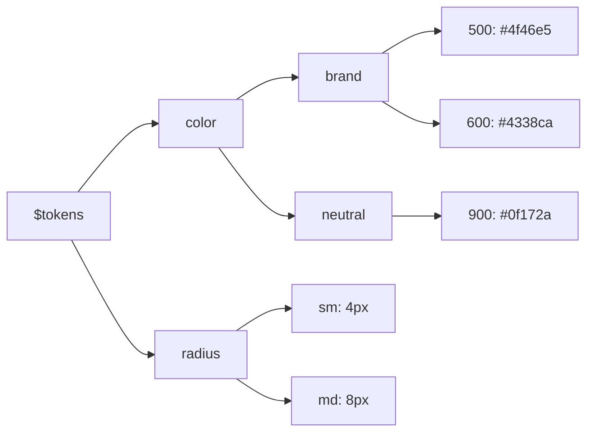

`map.merge()` is shallow, `map.deep-merge()` is recursive. The difference decides whether a theme override deletes its siblings:

```scss
@use "sass:map";

$base: ("a": ("b": 1, "c": 2));
$override: ("a": ("c": 3));

@debug map.merge($base, $override);        // ("a": ("c": 3)): "b" is gone
@debug map.deep-merge($base, $override);   // ("a": ("b": 1, "c": 3))
```

A safe nested lookup, adapted from the original guide's theme palette:

```scss
@use "sass:map";

$theme-palette: (
  "light": ("background": #ffffff, "surface": #f8fafc, "text": #0f172a, "border": #e2e8f0),
  "dark": ("background": #0b0f19, "surface": #111827, "text": #f9fafb, "border": #1f2937),
);

@function theme-color($mode, $key) {
  @if not map.has-key($theme-palette, $mode) {
    @error "Unknown theme mode `#{$mode}`. Expected one of: #{map.keys($theme-palette)}.";
  }
  @if not map.has-key($theme-palette, $mode, $key) {
    @error "Key `#{$key}` does not exist in theme mode `#{$mode}`.";
  }
  @return map.get($theme-palette, $mode, $key);
}

.card {
  background-color: theme-color("light", "surface");   // #f8fafc
  color: theme-color("light", "text");                 // #0f172a
}
```

Iterating a map gives you each key and value; with a single variable you get two-element lists:

```scss
$sizes: ("sm": 1px, "md": 2px);

@each $key, $value in $sizes {
  .p-#{$key} { padding: $value; }      // .p-sm, .p-md
}
```

Duplicate keys in a map literal are a compile error (`Duplicate key.`), which catches copy-paste mistakes in token files.

### 3.6 Writing Functions with @function and @error

A function takes arguments, runs Sass statements and returns one value with `@return`. Functions cannot emit CSS; that is what mixins are for ([Stage 4](#4-stage-4-mixins-content-blocks--control-flow)).

```scss
// src/scss/abstracts/_functions.scss (excerpt)
@use "sass:map";
@use "variables" as v;

/// Looks up a colour token and fails the build on a typo.
@function palette($key) {
  @if not map.has-key(v.$colors, $key) {
    @error "Unknown colour token `#{$key}`. Known tokens: #{map.keys(v.$colors)}.";
  }

  @return map.get(v.$colors, $key);
}
```

| Line / API | Role | What happens at compile time |
| :--- | :--- | :--- |
| `@use "variables" as v` | Loads the token module | The function reads `v.$colors`, including any value configured with `with`. |
| `@function palette($key)` | Public function | Callable as `a.palette("primary")` through the barrel. |
| `map.has-key(v.$colors, $key)` | Validation | Returns a boolean without throwing. |
| `@error "..."` | Fails the compilation | Prints the message, the call stack and the source line; no CSS file is written. |
| `#{map.keys(v.$colors)}` | Interpolates a list into the message | The developer sees every valid key. |
| `@return map.get(...)` | The result | Substituted wherever the call appears. |

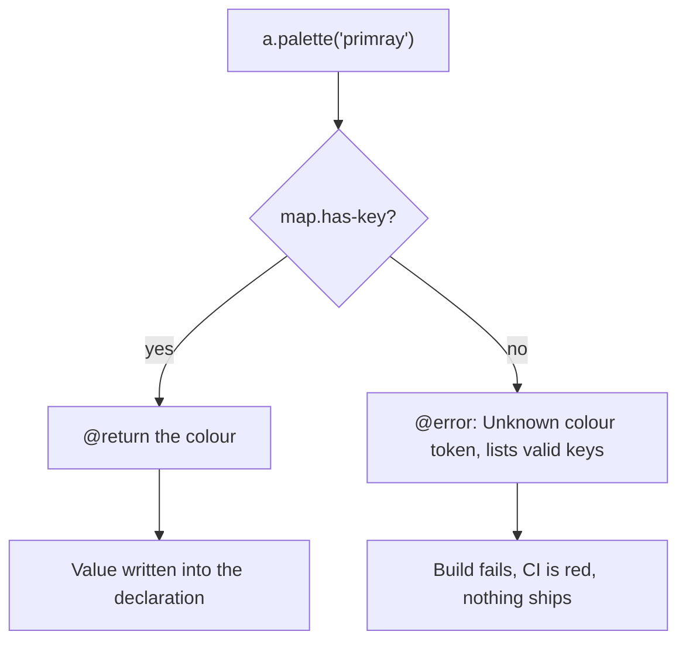

Three diagnostic directives, and when to use each:

| Directive | Effect | Use |
| --- | --- | --- |
| `@error "msg"` | Stops compilation | Invalid input that would produce wrong CSS. |
| `@warn "msg"` | Prints `WARNING: msg` with a stack trace, compilation continues | Deprecating your own tokens or mixins. Silenced by `--quiet`. |
| `@debug expr` | Prints `file.scss:12 DEBUG: <value>` | Inspecting values while developing. Remove before committing. |

Arguments work like mixin arguments: defaults (`$base: 16px`), keyword calls (`rem($px: 24px)`), rest arguments (`$values...`) and trailing commas (allowed everywhere since 1.83.0). Avoid naming functions after CSS functions. `type()` is reserved outright since 1.92.0, `url()` and `if()` have special parsing, and a function called `color()` reads like the CSS Color 4 `color()` function to every reviewer and tool. That is why the starter's colour lookup is `palette()`.

### 3.7 Colour Functions and Colour Spaces

Since Dart Sass 1.79.0, every colour knows the space it was written in (`rgb`, `hsl`, `hwb`, `lab`, `lch`, `oklab`, `oklch`, `display-p3` and more). Functions take a `$space` argument for where to do the maths, and return the colour in its original space.

```scss
@use "sass:color";

$brand: #4f46e5;

@debug color.space($brand);                                   // rgb
@debug color.channel($brand, "hue", $space: hsl);             // 243.39622641509436deg
@debug color.channel($brand, "lightness", $space: oklch);     // 51.05731017445264%
@debug color.to-space($brand, oklch);                         // oklch(51.057...% 0.230... 276.965...deg)
@debug color.change($brand, $alpha: 0.5);                     // rgba(79, 70, 229, 0.5)
@debug color.scale($brand, $lightness: 20%);                  // 20% of the way to white, in HSL
@debug color.adjust($brand, $lightness: -8%, $space: oklch);  // 8 points darker, perceptually
@debug color.mix($brand, white, 50%);                         // halfway, mixed in rgb
@debug color.same(#ff0000, rgb(255 0 0));                     // true
```

| Function | Semantics | Example use |
| --- | --- | --- |
| `color.adjust($c, $lightness: -8%, $space: oklch)` | Adds a fixed amount to a channel | Hover and active states. |
| `color.scale($c, $lightness: 20%)` | Moves a channel a percentage of the remaining distance | Tint scales that never overshoot. |
| `color.change($c, $alpha: 0.5)` | Sets a channel to a value | Translucent variants. |
| `color.mix($a, $b, $weight, $method: oklch)` | Interpolates between two colours | Blending brand colours. |
| `color.channel($c, "red", $space: rgb)` | Reads a channel | Contrast and luminance maths. |
| `color.to-space($c, oklch)` | Converts | Emitting modern syntax. |
| `color.to-gamut($c, $space: rgb, $method: local-minde)` | Maps an out-of-gamut colour into a space | After adjusting in a wide space. |
| `color.is-in-gamut($c, $space: rgb)` | Checks displayability | Test assertions. |

Why lightness in OKLCH: HSL lightness is not perceptual. A yellow at HSL lightness 53% looks much lighter than a blue at 53%. OKLCH lightness tracks perception, so "8 points darker" looks equally darker on every hue. The catch is that a colour adjusted in OKLCH may fall outside sRGB. Sass then emits it with impossible channel values, for example `color.mix(#4f46e5, #06b6d4, 50%, $method: oklch)` returns `rgb(-16.59%, 53.73%, 90.45%)`. Map it back with `color.to-gamut()`, which is exactly what the starter's `shade()` does:

```scss
// src/scss/abstracts/_functions.scss
/// Darkens a colour by $amount of OKLCH lightness, then maps the result back
/// into the sRGB gamut so it serialises as a plain, displayable rgb() colour.
@function shade($color, $amount) {
  $darker: color.adjust($color, $lightness: $amount * -1, $space: oklch);

  @return color.to-gamut($darker, $space: rgb, $method: local-minde);
}
```

`local-minde` is the CSS Color 4 gamut-mapping algorithm: it reduces chroma while keeping lightness and hue as close as possible. `$method: clip` simply clamps channels, which is faster but shifts hue.

The deprecated global colour functions and their replacements:

| Deprecated | Replacement |
| --- | --- |
| `darken($c, 10%)` | `color.adjust($c, $lightness: -10%)` (same HSL maths), or `$space: oklch` for perceptual |
| `lighten($c, 10%)` | `color.adjust($c, $lightness: 10%)` |
| `fade-out($c, 0.2)`, `transparentize()` | `color.adjust($c, $alpha: -0.2)` |
| `saturate($c, 10%)` | `color.adjust($c, $saturation: 10%)` |
| `red($c)`, `hue($c)` | `color.channel($c, "red", $space: rgb)`, `color.channel($c, "hue", $space: hsl)` |
| `mix($a, $b)` | `color.mix($a, $b)` |

### 3.8 Computing WCAG Contrast

WCAG 2 defines the contrast ratio between two colours as `(L1 + 0.05) / (L2 + 0.05)`, where L1 is the lighter colour's relative luminance. Normal text needs 4.5:1 for level AA, large text 3:1. Relative luminance comes from linearised sRGB channels weighted by how sensitive the eye is to each.

An earlier version of this guide picked text colour by HSL lightness (dark text above 60%). That heuristic fails on exactly the colours where it matters: yellow `#facc15` has an HSL lightness of 53%, so it got white text at a contrast of 1.53:1, and cyan `#06b6d4` got white at 2.43:1. The starter computes the real ratio instead:

```scss
// src/scss/abstracts/_functions.scss
// stylelint-disable-next-line number-max-precision -- exact value from the sRGB spec
$-srgb-linear-threshold: 0.04045;

@function -to-linear($channel) {
  $c: math.div($channel, 255);

  @if $c <= $-srgb-linear-threshold {
    @return math.div($c, 12.92);
  }

  @return math.pow(math.div($c + 0.055, 1.055), 2.4);
}

/// WCAG 2 relative luminance of a colour, from 0 (black) to 1 (white).
@function luminance($color) {
  $r: -to-linear(color.channel($color, "red", $space: rgb));
  $g: -to-linear(color.channel($color, "green", $space: rgb));
  $b: -to-linear(color.channel($color, "blue", $space: rgb));

  @return 0.2126 * $r + 0.7152 * $g + 0.0722 * $b;
}

/// WCAG 2 contrast ratio between two colours, from 1 to 21.
@function contrast-ratio($a, $b) {
  $la: luminance($a);
  $lb: luminance($b);

  @return math.div(math.max($la, $lb) + 0.05, math.min($la, $lb) + 0.05);
}

/// Picks whichever of $light or $dark has the higher contrast on $background.
@function on-color($background, $light: #fff, $dark: map.get(v.$colors, "ink")) {
  @if contrast-ratio($background, $light) >= contrast-ratio($background, $dark) {
    @return $light;
  }

  @return $dark;
}
```

| Line / API | Role |
| :--- | :--- |
| `color.channel($color, "red", $space: rgb)` | Reads the red channel on a 0-255 scale, converting first if the colour is in another space. |
| `-to-linear()` | Undoes the sRGB transfer curve. The 0.04045 threshold and 2.4 exponent come from the sRGB standard. |
| `0.2126 * $r + 0.7152 * $g + 0.0722 * $b` | Weights green highest: the eye is most sensitive to it. |
| `math.max($la, $lb) + 0.05` | The lighter colour goes on top, so the ratio is always at least 1. |
| `on-color()` | Returns whichever candidate scores higher; buttons use it so no variant can ship with unreadable text. |

Results for the starter's button colours against white and the `ink` token `#0f172a`:

| Background | Luminance | vs white | vs ink | `on-color()` picks |
| --- | --- | --- | --- | --- |
| `#4f46e5` primary | 0.117 | 6.29 | 2.84 | `#fff` |
| `#06b6d4` accent | 0.3825 | 2.43 | 7.35 | `#0f172a` |
| `#facc15` warning | 0.6356 | 1.53 | 11.66 | `#0f172a` |
| `#dc2626` danger | 0.1674 | 4.83 | 3.70 | `#fff` |

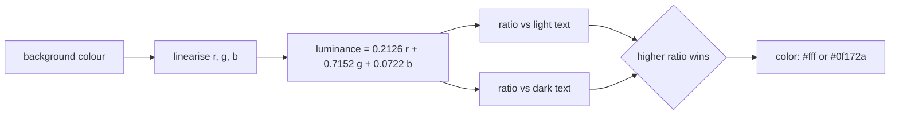

`on-color()` picks the better of two candidates; it does not guarantee 4.5:1. To enforce a minimum, add a guard and run it in tests:

```scss
@use "sass:math";
@use "../abstracts" as a;

@mixin assert-readable($background, $text, $minimum: 4.5) {
  $ratio: a.contrast-ratio($background, $text);

  @if $ratio < $minimum {
    @error "Contrast #{math.div(math.round($ratio * 100), 100)}:1 is below #{$minimum}:1 for #{$text} on #{$background}.";
  }
}
```

WCAG 3 drafts are exploring a different contrast model, but none is a standard yet. The WCAG 2 ratio is what audits and accessibility laws reference today. (Older copies of WCAG 2 print the threshold as 0.03928; the difference changes no 8-bit channel value.)

### 3.9 Fluid Values with clamp()

A fluid value grows linearly with the viewport between a minimum and a maximum. The CSS is `clamp(min, intercept + slope * 100vw, max)`. Computing the slope and intercept by hand is error-prone, so the starter does it in Sass:

```scss
// src/scss/abstracts/_functions.scss
@function fluid($min, $max, $min-vw: v.$fluid-min-viewport, $max-vw: v.$fluid-max-viewport) {
  $slope: math.div($max - $min, $max-vw - $min-vw);
  $intercept: $min - $slope * $min-vw;

  @return clamp(rem($min), rem($intercept) + $slope * 100vw, rem($max));
}
```

Worked through for `fluid(16px, 28px)` with the default 320px to 1280px range:

| Step | Expression | Value |
| --- | --- | --- |
| Slope | `(28px - 16px) / (1280px - 320px)` | `0.0125` (unitless: px cancels) |
| Intercept | `16px - 0.0125 * 320px` | `12px` |
| Preferred value | `rem(12px) + 0.0125 * 100vw` | `0.75rem + 1.25vw` |
| Result | `clamp(rem(16px), ..., rem(28px))` | `clamp(1rem, 0.75rem + 1.25vw, 1.75rem)` |

At a 320px viewport, `0.75rem + 1.25vw` is 12px + 4px = 16px; at 1280px it is 12px + 16px = 28px. Because the function returns a real calculation (no interpolation), Sass checks the units: passing `fluid(1rem, 2rem)` fails inside `rem()` with `rem() expects a px length, got 1rem.` instead of writing broken CSS. The original guide's `fluid-scale()` divided rem by px and interpolated the result into a string, which produced an invalid `rem/px` unit; this version fixes that.

Using rem for the minimum and maximum keeps the text zoomable: if a user sets a larger default font size, the bounds grow with it. A pure `vw` value would ignore that setting, which fails WCAG's resize-text criterion.

### 3.10 Testing Functions with sass-true

Functions are pure, so they are easy to unit-test. [sass-true](https://www.oddbird.net/true/) provides `describe`/`it` blocks and assertions written in SCSS. The starter's suites live in `tests/*.test.scss`:

```scss
// tests/functions.test.scss (excerpt)
@use "true" as *;
@use "../src/scss/abstracts" as a;

@include describe("contrast-ratio()") {
  @include it("is 21 for black on white and 1 for a colour on itself") {
    @include assert-equal(a.contrast-ratio(#000, #fff), 21);
    @include assert-equal(a.contrast-ratio(#4f46e5, #4f46e5), 1);
  }
}

@include describe("fluid()") {
  @include it("emits a clamp() that grows between 320px and 1280px") {
    @include assert {
      @include output {
        font-size: a.fluid(16px, 28px);
      }

      @include expect {
        font-size: clamp(1rem, 0.75rem + 1.25vw, 1.75rem);
      }
    }
  }
}
```

| Assertion | Compares | Use |
| --- | --- | --- |
| `assert-equal($a, $b)` | Two Sass values with `==` | Function results. Sass compares numbers to 10 decimal places, so `21` matches a computed 20.99999999999. |
| `assert-true($x)` / `assert-false($x)` | Truthiness | Predicates such as `color.is-in-gamut()`. |
| `assert { output {...} expect {...} }` | The compiled CSS of two blocks | Mixins and anything whose output format matters. |

The runner, `tests/sass.test.js`, is the only JavaScript in the project. It passes Node's built-in `describe` and `it` to sass-true for each `.test.scss` file, and adds one end-to-end test that compiles `main.scss` and fails on any warning. Run it with `npm test`:

```text
# Subtest: contrast-ratio()
    ok 1 - is 21 for black on white and 1 for a colour on itself
    ok 2 - passes WCAG AA (4.5:1) for white on the primary colour
...
# tests 18
# pass 18
# fail 0
```

Because `@error` stops compilation, sass-true cannot catch it inside a normal assertion. Test error paths by compiling a small file from the runner and asserting that it throws, or keep them obvious and covered by the build itself.

### 3.11 Pitfalls

| Pitfall | Symptom | Fix |
| --- | --- | --- |
| Looking up a missing map key | The declaration vanishes from the output with no warning | Wrap lookups in a function that calls `@error` on unknown keys. |
| Adding incompatible units | `Error: 1px and 1em have incompatible units.` | Convert first (`rem()`), or let the browser do it with `calc(1px + 1em)`. |
| Multiplying two lengths | `calc(20px * 1px)` appears in the CSS | A division is missing: `math.div($a, 1px) * $b`. |
| Indexing a list from 0 | `Error: $n: List index may not be 0.` | Lists start at 1; use -1 for the last item. |
| `map.merge()` for nested overrides | Sibling keys of the overridden branch disappear | Use `map.deep-merge()`. |
| Choosing text colour by HSL lightness | White text on yellow at 1.53:1 | Compute WCAG luminance, as `on-color()` does. |
| Mixing or adjusting in OKLCH and emitting directly | Channels outside 0-100%, such as `rgb(-16.59%, ...)` | Wrap with `color.to-gamut($c, $space: rgb, $method: local-minde)`. |
| Using `darken()`/`lighten()` | `DEPRECATION WARNING [global-builtin]` and uneven results across hues | `color.adjust(..., $space: oklch)` plus gamut mapping. |
| Defining a function named `color()` or `type()` | Calls parse as CSS functions; `type` is a compile error since 1.92.0 | Pick a name that is not a CSS function: `palette()`. |
| Duplicate keys in a token map | `Error: Duplicate key.` | Delete the duplicate; the error points at both. |
| Treating `0` or `""` as false | `@if $n` runs for `0` | Compare explicitly: `@if $n != 0`. |

### 3.12 Best Practices

- Keep functions pure: same input, same output, no CSS; that makes them testable with `assert-equal`.
- Validate types and keys with `@error` at the boundary: a failed build is cheaper than a wrong pixel in production.
- Put the valid options in every error message: the developer fixes the typo without opening the token file.
- Store tokens in maps, not lists: names survive reordering and can be validated.
- Use `map.deep-merge()` for theme overrides: partial overrides keep the rest of the tree.
- Use `math.div()` and calculations, never `/`: `/` division is removed in Dart Sass 2.0.0.
- Do colour maths in OKLCH and map back to sRGB: equal steps look equal on every hue and stay displayable.
- Compute contrast from WCAG luminance, not lightness: lightness heuristics fail on yellows and cyans.
- Express fluid bounds in rem: zoom and user font-size settings keep working.
- Test every public function: a sass-true suite runs in about a second and documents the expected values.

### 3.13 Hands-on Exercise

Add a nested-token lookup with full validation, and test it.

1. In `exercises/stage-3/_tokens.scss`, define a `$tokens` map with `"color"` (containing a `"brand"` map with keys `500` and `600`) and `"radius"` (`"sm"`, `"md"`).
2. Write `token($path...)` that walks the map with the rest arguments, calls `@error` naming the first missing key, and returns the value. Use `map.has-key($map, $key)` one level at a time.
3. Write `exercises/stage-3/tokens.test.scss` with sass-true assertions that `token("color", "brand", 500)` is `#4f46e5` and `token("radius", "md")` is `8px`.

`npm test` picks up `*.test.scss` files in `exercises/` as well as `tests/`, so the expected output is two more passing tests:

```text
# Subtest: token()
    ok 1 - walks nested maps with rest arguments
    ok 2 - reads a top-level group
```

The solution is in `exercises/stage-3/_tokens.scss` and `exercises/stage-3/tokens.test.scss`. Calling `token("color", "brand", 700)` should fail the build with `Unknown token key 700 under $tokens.color.brand.`

[Back to top ⤴️](#-table-of-contents)

---

## 4. Stage 4: Mixins, Content Blocks & Control Flow

Mixins package reusable groups of declarations and rules; control flow (`@if`, `@each`, `@for`, `@while`) generates CSS from data. Together they turn the token maps from Stage 3 into components and utility classes. This stage assumes Stages 1-3.

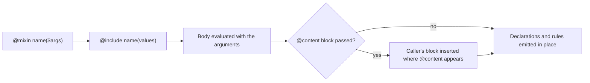

### 4.1 Mixin Ergonomics with Default Parameters

Mixins encapsulate reusable blocks of styling rules. Defaults make the common case short, and keyword arguments make call sites self-documenting:

```scss
@mixin flex-layout($direction: row, $justify: flex-start, $align: stretch, $wrap: nowrap) {
  display: flex;
  flex-direction: $direction;
  justify-content: $justify;
  align-items: $align;
  flex-wrap: $wrap;
}

// Keyword arguments skip the parameters you do not need to change
.nav-bar {
  @include flex-layout($justify: space-between, $align: center);
}
```

### 4.2 Content Blocks with @content

A mixin that ends with `@content` accepts a block from the caller. The starter's `respond-to()` uses this to wrap any declarations in a media query:

```scss
// src/scss/abstracts/_mixins.scss
@mixin respond-to($breakpoint) {
  @if not map.has-key(v.$breakpoints, $breakpoint) {
    @error "Unknown breakpoint `#{$breakpoint}`. Known breakpoints: #{map.keys(v.$breakpoints)}.";
  }

  @media (min-width: map.get(v.$breakpoints, $breakpoint)) {
    @content;
  }
}

// src/scss/layout/_grid.scss
.grid {
  grid-template-columns: 1fr;

  @include a.respond-to("sm") { grid-template-columns: repeat(2, 1fr); }
}
// Output: .grid { ... } @media (min-width: 640px) { .grid { grid-template-columns: repeat(2, 1fr); } }
```

`@content` can also pass values back to the caller with `using`:

```scss
@mixin each-breakpoint($breakpoints) {
  @each $name, $width in $breakpoints {
    @media (min-width: $width) {
      @content($name);
    }
  }
}

@include each-breakpoint(("md": 768px, "lg": 1024px)) using ($name) {
  .hide-#{$name} { display: none; }
}
```

### 4.3 Accessible Focus Ring Mixin

```scss
@mixin focus-ring($color: #6366f1, $offset: 2px, $width: 2px) {
  &:focus-visible {
    outline: $width solid $color;
    outline-offset: $offset;
  }
}

.button,
.input-field {
  @include focus-ring;
}
```

`:focus-visible` shows the ring for keyboard users and hides it for mouse clicks. Never remove the outline without replacing it: keyboard users then cannot see where they are.

### 4.4 Multi-Line Text Clamping

```scss
@mixin line-clamp($lines: 2) {
  display: -webkit-box;
  -webkit-line-clamp: $lines;
  -webkit-box-orient: vertical;
  overflow: hidden;
}

.card__excerpt {
  @include line-clamp(3);
}
```

The prefixed form is still the cross-browser way to clamp lines; the unprefixed `line-clamp` property is specified but not yet usable everywhere.

### 4.5 Responsive Auto-Fitting CSS Grid

```scss
@mixin auto-grid($min-col-width: 280px, $gap: 1.5rem) {
  display: grid;
  grid-template-columns: repeat(auto-fill, minmax(min($min-col-width, 100%), 1fr));
  gap: $gap;
}

.catalog-grid {
  @include auto-grid(250px, 2rem);
}
```

`min($min-col-width, 100%)` stops the grid from overflowing on screens narrower than one column.

### 4.6 Dynamic Utility Generation with @each Loops

Instead of writing hundreds of margin and padding utilities by hand, generate them from token maps:

```scss
@use "sass:meta";

$spacers: ("0": 0, "1": 0.25rem, "2": 0.5rem, "3": 1rem, "4": 1.5rem, "5": 3rem);

$directions: (
  "t": "top",
  "b": "bottom",
  "l": "left",
  "r": "right",
  "x": ("left", "right"),
  "y": ("top", "bottom"),
);

@each $space-key, $space-val in $spacers {
  .m-#{$space-key} { margin: $space-val; }
  .p-#{$space-key} { padding: $space-val; }

  @each $dir-key, $dir-val in $directions {
    .m#{$dir-key}-#{$space-key} {
      @if meta.type-of($dir-val) == "list" {
        @each $sub-dir in $dir-val {
          margin-#{$sub-dir}: $space-val;
        }
      } @else {
        margin-#{$dir-val}: $space-val;
      }
    }
  }
}
```

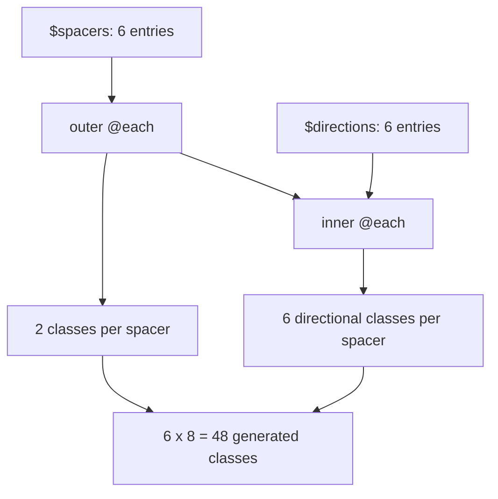

Every generated class ships to the browser whether or not any HTML uses it. Count the output before adding another dimension to a loop.

### 4.7 Responsive Grid Generator with @for Loops

```scss
@use "sass:math";

$grid-columns: 12;

.row {
  display: flex;
  flex-wrap: wrap;
  margin-inline: -15px;
}

@for $i from 1 through $grid-columns {
  .col-#{$i} {
    flex: 0 0 math.percentage(math.div($i, $grid-columns));
    max-width: math.percentage(math.div($i, $grid-columns));
    padding-inline: 15px;
  }
}
```

`from 1 through 12` includes 12; `from 1 to 12` stops at 11. With CSS Grid, a 12-column system rarely needs generated classes at all: `grid-column: span 4` does the same job.

### 4.8 Algorithmic Elevation Shadow Matrix

```scss
$elevations: (
  1: (0 1px 3px rgb(0 0 0 / 0.12), 0 1px 2px rgb(0 0 0 / 0.24)),
  2: (0 3px 6px rgb(0 0 0 / 0.15), 0 2px 4px rgb(0 0 0 / 0.12)),
  3: (0 10px 20px rgb(0 0 0 / 0.15), 0 3px 6px rgb(0 0 0 / 0.1)),
  4: (0 15px 25px rgb(0 0 0 / 0.15), 0 5px 10px rgb(0 0 0 / 0.05)),
);

@each $level, $shadow-layers in $elevations {
  .elevation-#{$level} {
    box-shadow: $shadow-layers;
  }
}
```

### 4.9 Mixins, @extend and Placeholders Compared

| | `@mixin` / `@include` | `@extend .class` | `@extend %placeholder` |
| --- | --- | --- | --- |
| Output | Declarations copied into each rule | The extending selector is added to the extended rule | Same, but the placeholder itself never emits |
| Arguments | Yes | No | No |
| Works inside `@media` across boundaries | Yes | No: `You may not @extend selectors across media queries.` | No |
| Surprise selectors | None | Can generate unexpected combinations wherever `.class` appears | Limited to where the placeholder is used |
| Compressed size | Repeated declarations compress well with gzip or Brotli | Long selector lists | Long selector lists |

Default to mixins. Use a placeholder when many unrelated selectors share a large, argument-free block and none of them sit in media queries.

### 4.10 Pitfalls

| Pitfall | Symptom | Fix |
| --- | --- | --- |
| Overusing `@extend` across modules | Long comma-separated selector chains and rules appearing far from their source | Use a mixin, or `@extend` a `%placeholder` within one module. |
| `@extend` inside a media query | `Error: You may not @extend selectors across media queries.` | Use a mixin. |
| Nested loops over large maps | CSS grows by thousands of rules | Generate only the steps the design uses; measure the output size in CI. |
| Generating class names with interpolation | Content-based purge tools cannot find `.m#{$k}-#{$v}` in templates | Safelist the generated patterns, or avoid purging that file. |
| `@for ... to` when you meant `through` | The last column class is missing | `through` is inclusive, `to` is exclusive. |

### 4.11 Best Practices

- Give mixin parameters defaults for the common case: most call sites become one short line.
- Call mixins with keyword arguments when there are more than two: the call reads without opening the definition.
- Validate mixin arguments with `@error`, as `respond-to()` does: a typo fails the build instead of emitting nothing.
- Prefer mixins to `@extend`: output is predictable and works inside media queries.
- Generate from token maps, never from magic numbers: the design and the CSS change in one place.

[Back to top ⤴️](#-table-of-contents)

---

## 5. Stage 5: 7-1 Architecture, BEM & Design Tokens

A stylesheet that one person can hold in their head does not need architecture; one that twenty people edit does. This stage covers the 7-1 folder pattern, an entry point that only defines load order, BEM naming with shallow nesting, and publishing Sass tokens as CSS custom properties. It builds on the module system (Stage 2) and maps (Stage 3).

Four principles hold the structure together:

1. **Modular encapsulation**: `@use` and `@forward` give every file explicit dependencies and private helpers.
2. **Tokens as the single source of truth**: maps define colours, spacing, type and breakpoints; components only read them.
3. **Generated, not hand-written, repetition**: loops and mixins build utilities and variants from those maps.
4. **Layers with one job each**: abstracts, base, layout, components, pages, themes and vendors, joined by one manifest.

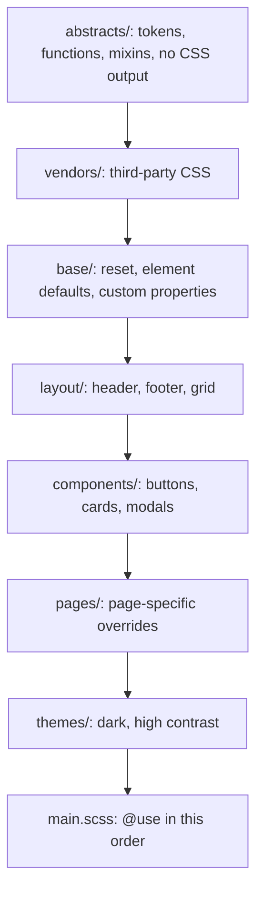

### 5.1 The 7-1 Architecture Breakdown

The 7-1 pattern organises a project into 7 folders and 1 entry file:

```text
sass/
|
|-- abstracts/              # Shared tooling that emits no CSS
|   |-- _variables.scss     # Token maps
|   |-- _functions.scss     # Unit conversion and colour helpers
|   |-- _mixins.scss        # Breakpoint and layout mixins
|   |-- _index.scss         # Barrel: @forward the three files above
|
|-- base/                   # Global boilerplate
|   |-- _reset.scss         # Box sizing and margin reset
|   |-- _typography.scss    # Element-level type styles
|
|-- components/             # Self-contained UI components
|   |-- _buttons.scss       # .btn, .btn--primary
|   |-- _card.scss          # .card, .card__header
|   |-- _modal.scss         # .modal
|
|-- layout/                 # Page skeleton
|   |-- _header.scss
|   |-- _footer.scss
|   |-- _grid.scss
|
|-- pages/                  # Page-specific overrides
|   |-- _dashboard.scss
|
|-- themes/                 # Visual themes
|   |-- _dark.scss
|
|-- vendors/                # Third-party styles (normalize, syntax highlighting)
|   |-- _normalize.scss
|
`-- main.scss               # Single compilation entry point
```

The starter uses four of the seven folders (`abstracts`, `base`, `layout`, `components`); add the others when you have something to put in them.

### 5.2 Entry Point Architecture (main.scss)

```scss
// 1. Vendors and base: lowest in the cascade
@use "vendors/normalize";
@use "base/reset";
@use "base/typography";

// 2. Layouts
@use "layout/header";
@use "layout/grid";
@use "layout/footer";

// 3. Components
@use "components/buttons";
@use "components/card";
@use "components/modal";

// 4. Pages and themes: last, so they win ties
@use "pages/dashboard";
@use "themes/dark";
```

The entry point does not need `@use "abstracts"`: every partial that needs the abstracts loads them itself, and abstracts emit no CSS. Add it only if `main.scss` configures them with `with`, and then put it first.

### 5.3 The BEM Naming Convention

- **Block**: a standalone component that is meaningful on its own (`.card`).
- **Element**: a part of a block that has no meaning outside it (`.card__title`, `.card__body`).
- **Modifier**: a flag that changes appearance or behaviour (`.card--elevated`, `.btn--disabled`).

Every BEM selector is a single class, so every rule has the same specificity (0-1-0). Order in the file, not selector weight, decides which wins. The starter's `.stylelintrc.json` enforces the naming with a `selector-class-pattern` regular expression.

### 5.4 Nesting Hygiene & the Inception Rule

Never nest more than three levels deep. Deep nesting (`.nav ul li a span`) ties CSS to the HTML structure, raises specificity, bloats the output and forces `!important` to override.

```scss
// Good: BEM nesting with the parent selector
.dialog {
  display: flex;
  background: var(--color-background);

  &__header {
    font-weight: 700;
  }

  &__content {
    padding: 1rem;
  }

  &--fullscreen {
    width: 100vw;
    height: 100vh;
  }
}
```

The starter's Stylelint config sets `max-nesting-depth: 3` and `selector-max-compound-selectors: 3`, so CI enforces the rule.

### 5.5 Compiling Tokens into CSS Custom Properties

Combining Sass maps with custom properties gives compile-time validation and runtime theming:

```scss
@use "sass:meta";

$design-tokens: (
  "color-primary": #6366f1,
  "color-primary-hover": #4f46e5,
  "color-background": #ffffff,
  "color-text": #0f172a,
  "font-family-base": ("Inter", -apple-system, "Segoe UI", sans-serif),
  "radius-md": 8px,
  "radius-lg": 16px,
  "shadow-sm": (0 1px 2px 0 rgb(0 0 0 / 0.05)),
);

:root {
  @each $token-name, $token-val in $design-tokens {
    // meta.inspect() keeps the quotes around "Segoe UI"; plain #{} would drop them
    --#{$token-name}: #{meta.inspect($token-val)};
  }
}

// The dark theme overrides only custom properties: no component CSS is duplicated
[data-theme="dark"] {
  --color-background: #0f172a;
  --color-text: #f8fafc;
  --color-primary: #818cf8;
}
```

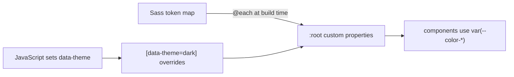

The starter's `base/_root.scss` does the same for `$colors` and `$spacing`. [M1](#m1-masterclass-design-tokens-to-runtime-theming) builds a complete theme engine on this idea.

### 5.6 Pitfalls

| Pitfall | Symptom | Fix |
| --- | --- | --- |
| Nesting four or more levels | Selectors like `.nav ul li a span` and overrides that need `!important` | Cap nesting at three levels and use BEM classes. |
| Interpolating quoted strings into custom properties | `--font: Segoe UI, sans-serif` loses its quotes | Use `#{meta.inspect($value)}`. |
| Components reading raw hex values | Rebranding means a search-and-replace across files | Read every value through token functions or custom properties. |
| Logic in `main.scss` | Load order and rules mixed together; cascade surprises | Keep the entry point to `@use` lines. |

### 5.7 Best Practices

- Never use `@import`: every stylesheet uses `@use` and `@forward`.
- Keep selector nesting at three levels at most: specificity stays flat and predictable.
- Reference a token for every colour, spacing and typography value: the design system stays the single source of truth.
- Order `main.scss` from generic to specific: later layers win ties without extra specificity.
- Publish tokens as custom properties at `:root`: themes become a handful of overrides instead of a second stylesheet.

[Back to top ⤴️](#-table-of-contents)

---

## 6. Stage 6: Responsive Layout, Tooling & Production Builds

The last stage before the masterclasses covers responsive engines (breakpoints, container queries, fluid type) and the build around Sass: PostCSS, Stylelint and npm scripts. It assumes everything before it.

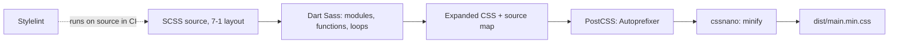

### 6.1 Mobile-First Breakpoint Engine

```scss
@use "sass:map";

$breakpoints: (
  "sm": 640px,
  "md": 768px,
  "lg": 1024px,
  "xl": 1280px,
  "2xl": 1536px,
);

@mixin respond-to($breakpoint) {
  @if not map.has-key($breakpoints, $breakpoint) {
    @error "Invalid breakpoint: #{$breakpoint}. Valid choices: #{map.keys($breakpoints)}";
  }

  @media (min-width: map.get($breakpoints, $breakpoint)) {
    @content;
  }
}

.responsive-panel {
  padding: 1rem;

  @include respond-to("md") { padding: 2rem; }
  @include respond-to("xl") { padding: 4rem; }
}
```

### 6.2 Container Queries with SCSS

Container queries style a component by the size of its container instead of the viewport, so the same card works in a sidebar and in a full-width hero:

```scss
.card-container {
  container-type: inline-size;
  container-name: card-wrapper;
}

.card {
  display: flex;
  flex-direction: column;

  @container card-wrapper (min-width: 450px) {
    flex-direction: row;
    align-items: center;

    &__image { width: 40%; }
    &__body { width: 60%; }
  }
}
```

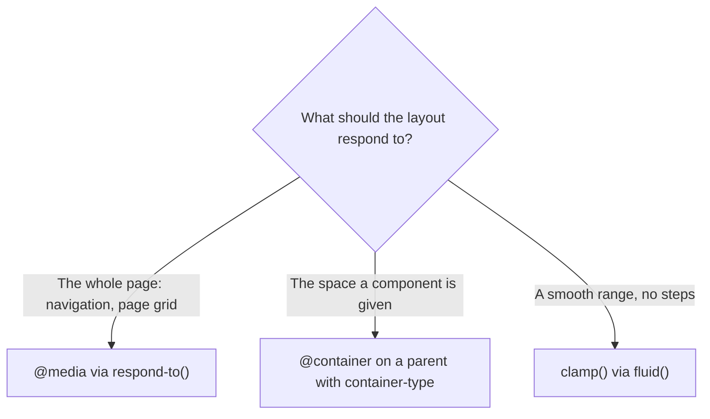

### 6.3 Fluid Typography with clamp()

Use the starter's `fluid()` function from [3.9](#39-fluid-values-with-clamp): `font-size: a.fluid(32px, 48px);` compiles to `clamp(2rem, 1.6666666667rem + 1.6666666667vw, 3rem)`. An earlier version of this section divided rem by px inside an interpolated `calc()` string, which produced an invalid unit; the function-based version keeps Sass's unit checks.

### 6.4 Production Build Pipeline

```bash
# Dart Sass compilation with source maps
sass src/main.scss dist/main.css --style=expanded --source-map

# PostCSS with Autoprefixer and cssnano
postcss dist/main.css --use autoprefixer cssnano -o dist/main.min.css
```

Autoprefixer reads your `browserslist` targets and adds only the vendor prefixes those browsers need. cssnano removes whitespace and comments, merges identical rules and shortens values.

### 6.5 Build Scripts in package.json

```json
{
  "scripts": {
    "sass:watch": "sass --watch src/scss/main.scss:dist/css/main.css --style=expanded --source-map",
    "sass:build": "sass src/scss/main.scss:dist/css/main.css --style=expanded --no-source-map",
    "postcss:build": "postcss dist/css/main.css --use autoprefixer cssnano -o dist/css/main.min.css",
    "build:css": "npm run sass:build && npm run postcss:build",
    "lint:scss": "stylelint \"src/scss/**/*.scss\""
  }
}
```

### 6.6 Stylelint Configuration

`stylelint-config-standard-scss` already includes `stylelint-config-recommended-scss`, so extending the standard config is enough. The starter's `.stylelintrc.json`:

```json
{
  "extends": ["stylelint-config-standard-scss"],
  "rules": {
    "max-nesting-depth": 3,
    "selector-max-compound-selectors": 3,
    "selector-class-pattern": [
      "^[a-z][a-z0-9]*(-[a-z0-9]+)*(__[a-z0-9]+(-[a-z0-9]+)*)?(--[a-z0-9]+(-[a-z0-9]+)*)?$",
      { "message": "Use BEM: block, block__element, block--modifier (kebab-case parts)" }
    ],
    "declaration-no-important": true
  }
}
```

A stricter team configuration adds naming and colour rules:

```json
{
  "extends": ["stylelint-config-standard-scss"],
  "rules": {
    "max-nesting-depth": 3,
    "selector-max-compound-selectors": 3,
    "scss/at-rule-no-unknown": true,
    "scss/dollar-variable-pattern": "^[a-z0-9]+(-[a-z0-9]+)*$",
    "scss/selector-no-redundant-nesting-selector": true,
    "color-named": "never",
    "color-hex-length": "short",
    "declaration-no-important": true
  }
}
```

### 6.7 Pitfalls

| Pitfall | Symptom | Fix |
| --- | --- | --- |
| Font sizes in px only | Text ignores the user's browser font-size setting | Use rem, and rem bounds in `clamp()`. |
| Media queries for component layout | A card breaks when moved into a sidebar | Use container queries for component-level layout. |
| Running cssnano before Autoprefixer | Prefixes added after minification, or rules merged wrongly | Prefix first, minify last. |
| Linting only compiled CSS | Nesting depth and naming problems are invisible | Run Stylelint on the `.scss` source. |

### 6.8 Best Practices

- Compile with source maps in development and without them in production: debugging stays easy and the source stays private.
- Keep breakpoints in one map read by one mixin: changing a breakpoint is a one-line edit.
- Use container queries for components and media queries for page layout: components stay portable.
- Fail CI on lint errors and Sass deprecations: regressions are caught in review, not production.

[Back to top ⤴️](#-table-of-contents)

---

## M1. Masterclass: Design Tokens to Runtime Theming

A theme engine turns one token tree into CSS custom properties for every theme, emitting only the values each theme changes. Sass does the validation and the maths (contrast, merges); the browser does the switching. The complete example lives in `examples/m1-theming/` and is covered by `npm test`.

### M1.1 How the Engine Works

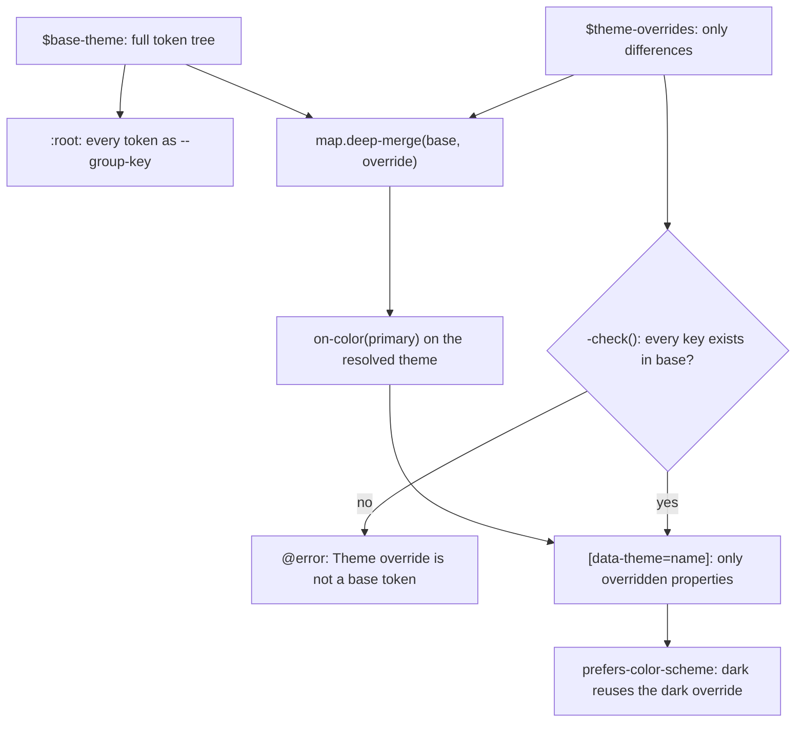

Three ideas make it work. Custom properties inherit, so a theme block only needs the values that differ from `:root`. `map.deep-merge()` produces the fully resolved theme in Sass, so derived values such as the text colour on the primary colour can be computed per theme. And every override is checked against the base tree, so a misspelt token fails the build instead of silently doing nothing.

### M1.2 Complete Worked Example

```scss
// examples/m1-theming/_theme-engine.scss (abridged: see the file for -check())
@use "sass:map";
@use "sass:meta";
@use "../../src/scss/abstracts" as a;

$base-theme: (
  "color": ("background": #ffffff, "surface": #f8fafc, "text": #0f172a, "primary": #4f46e5),
  "radius": ("md": 8px),
) !default;

$theme-overrides: (
  "dark": ("color": ("background": #0f172a, "surface": #1e293b, "text": #f8fafc, "primary": #818cf8)),
  "high-contrast": ("color": ("text": #000, "primary": #1e1b8a)),
) !default;

// Flattens ("color": ("text": #000)) into --color-text: #000.
@mixin -emit($tree, $prefix: "") {
  @each $key, $value in $tree {
    $name: if(sass($prefix == ""): $key; else: "#{$prefix}-#{$key}");

    @if meta.type-of($value) == "map" {
      @include -emit($value, $name);
    } @else {
      --#{$name}: #{meta.inspect($value)};
    }
  }
}

@mixin -on-primary($resolved) {
  --color-on-primary: #{a.on-color(map.get($resolved, "color", "primary"))};
}

@mixin themes {
  :root {
    @include -emit($base-theme);
    @include -on-primary($base-theme);
  }

  @each $name, $override in $theme-overrides {
    @include -check($override);

    [data-theme="#{$name}"] {
      @include -emit($override);
      @include -on-primary(map.deep-merge($base-theme, $override));
    }
  }
}

/// var() reference with a compile-time check that the token exists.
@function token($path...) {
  @if not map.has-key($base-theme, $path...) {
    @error "Unknown theme token #{$path}.";
  }

  $name: "";

  @each $part in $path {
    $name: if(sass($name == ""): $part; else: "#{$name}-#{$part}");
  }

  @return var(--#{$name});
}
```

```scss
// examples/m1-theming/demo.scss
@use "theme-engine" as theme;

@include theme.themes;

.btn-primary {
  color: var(--color-on-primary);
  background: theme.token("color", "primary");
  border-radius: theme.token("radius", "md");
}
```

Part of the output of `npx sass --no-source-map examples/m1-theming/demo.scss`:

```css
[data-theme=dark] {
  --color-background: #0f172a;
  --color-surface: #1e293b;
  --color-text: #f8fafc;
  --color-primary: #818cf8;
  --color-on-primary: #0f172a;
}

[data-theme=high-contrast] {
  --color-text: #000;
  --color-primary: #1e1b8a;
  --color-on-primary: #fff;
}
```

The dark theme's lighter primary gets dark text, computed rather than guessed. Switching themes at runtime is one attribute: `document.documentElement.dataset.theme = "dark"`.

### M1.3 Trade-offs Against the Alternatives

| Approach | Output size | Runtime switching | Build-time checks | Best for |
| --- | --- | --- | --- | --- |
| Sass tokens to custom properties (this engine) | One token block per theme | Yes, one attribute | Yes: keys, contrast | Design systems with several themes |
| A separate compiled stylesheet per theme | Whole stylesheet per theme | Swap the `<link>` | Yes | Themes that change layout, not just values |
| Custom properties written by hand | Smallest | Yes | None | A handful of tokens |
| CSS `light-dark()` | Two values per declaration | Follows `color-scheme` | None | Exactly two themes, light and dark |
| Runtime CSS-in-JS theme provider | Styles injected by JS | Yes | Type-checked in TS | Apps already rendering styles in JS |

### M1.4 Production Checklist

- Every override key is validated against the base tree; a typo fails CI.
- Derived tokens (text on brand colours, borders, focus rings) are computed per resolved theme, not copied.
- Every theme passes a contrast test in the SCSS test suite.
- `prefers-color-scheme` applies only when the user has not chosen a theme explicitly (`:root:not([data-theme])`).
- The token tree is the only place a raw colour appears; Stylelint's `color-no-hex` can enforce that in components.

[Back to top ⤴️](#-table-of-contents)

---

## M2. Masterclass: Cascade Layers & Specificity Control

`@layer` lets you declare the priority of whole groups of rules up front, so a reset can never beat a component and a utility always beats both, whatever their selectors' specificity. Sass passes `@layer` through unchanged, but the way Sass orders module output decides whether your layer order works.

### M2.1 How Layer Order Is Decided, and Where Sass Interferes

The browser ranks layers by the order in which their names **first appear** in the CSS. A statement such as `@layer reset, base, components, utilities;` fixes that order, but only if it comes first. Sass emits the CSS of every `@use`d module before the CSS of the file that loads it, and `@use` must be the first rule in a file. So this looks right and is wrong:

```scss
// main.scss: the layer statement ends up after components' CSS
@use "components/buttons";            // emits @layer components { ... }
@layer reset, base, components;       // too late: components was named first
```

```css
@layer components { .btn { ... } }    /* components declared first = lowest priority */
@layer reset, base, components;
```

```mermaid
sequenceDiagram
    participant M as main.scss
    participant L as _layers.scss
    participant B as _buttons.scss
    participant O as Output CSS
    M->>L: @use "layers" (first line)
    L->>O: @layer reset, base, components, utilities
    M->>B: @use "components/buttons"
    B->>O: @layer components with the .btn rules
    Note over O: Order fixed before any layer has content
```

The fix is a module whose only output is the layer statement, loaded first.

### M2.2 Complete Worked Example

```scss
// _layers.scss
@layer reset, vendor, base, components, utilities;

// components/_buttons.scss
@layer components {
  .btn { padding: 0.5rem 1rem; }
}

// main.scss
@use "sass:meta";
@use "layers";                     // must be the first @use
@use "components/buttons";

// Third-party CSS goes into its own low-priority layer. meta.load-css() can
// be nested; @use cannot.
@layer vendor {
  @include meta.load-css("vendors/datepicker");
}

@layer utilities {
  .hidden { display: none; }
}
```

Unlayered styles beat every layer. Code you cannot wrap, such as styles injected by a widget at runtime, therefore wins over all of your layered CSS; leave room for that when you decide what to layer.

### M2.3 Trade-offs Against the Alternatives

| Technique | Controls priority by | Weakness |
| --- | --- | --- |
| `@layer` | Declared order of layers | Unlayered CSS beats all layers; the order statement must come first in the output |
| BEM single-class selectors | Equal specificity plus source order | Breaks as soon as someone writes `.page .btn` |
| `:where()` wrappers | Zero specificity for library selectors | Every consumer selector wins, including accidental ones |
| `!important` | Brute force | Escalates; inside layers the priority of `!important` is reversed |

### M2.4 Production Checklist

- `_layers.scss` is the first `@use` in every entry point.
- Vendor CSS is loaded through `meta.load-css()` inside `@layer vendor`.
- Utilities live in the last layer, so they need no `!important`.
- A test asserts that the compiled CSS starts with the layer statement.

[Back to top ⤴️](#-table-of-contents)

---

## M3. Masterclass: Migrating a Large Codebase off @import

`@import` will be removed in Dart Sass 3.0.0. In a large codebase the migration is mechanical but must be staged, because shared partials are loaded by many entry points and some consumers may be outside your repository.

### M3.1 How the Module Migrator Works

```mermaid
flowchart TD
    E["Entry point"] --> P["Parse the @import graph"]
    P --> R["Record which file defines each member"]
    R --> U["Rewrite @import to @use with namespaces"]
    U --> NS["Add namespaces to every reference: $x becomes ns.$x"]
    NS --> FN["Rewrite global functions: map-get becomes map.get"]
    FN --> FW["Optionally add @forward for library entry points"]
    FW --> OUT["Write files, or print a diff with --dry-run --verbose"]
```

`sass-migrator module` resolves every variable, mixin and function to the file that defines it, then rewrites both the load rules and every reference. Files that already use `@use` are assumed migrated and left alone.

### M3.2 Complete Worked Example

Before:

```scss
// _variables.scss
$brand: #4f46e5;

// _buttons.scss
.btn { background: darken($brand, 10%); }

// main.scss
@import "variables";
@import "buttons";
```

Run:

```bash
npx sass-migrator --migrate-deps --dry-run --verbose module main.scss   # review the diff
npx sass-migrator --migrate-deps module main.scss                       # apply
```

After: the target shape, written by hand. The migrator's output can differ in detail, for example in the namespaces it picks; review the diff rather than expecting this text byte for byte.

```scss
// _buttons.scss
@use "sass:color";
@use "variables";

.btn { background: color.adjust(variables.$brand, $lightness: -10%); }

// main.scss
@use "buttons";
```

`main.scss` no longer needs `variables`, because nothing in it uses a member of that file and `_buttons.scss` now loads it itself. If a migrated file keeps a `@use` it does not need, delete it by hand.

### M3.3 Trade-offs: Big Bang or Incremental

| Strategy | How | Risk | Use when |
| --- | --- | --- | --- |
| Big bang | Run the migrator on every entry point in one pull request | One large diff to review | One team owns all the SCSS |
| Incremental with import-only files | Migrate a library to `@use`, and add `_name.import.scss` files that `@forward` with the old prefixed names for consumers still on `@import` | Two entry points to maintain for a while | A shared library with consumers you do not control |
| Leaf-first | Migrate partials with no dependencies, then work up the graph | Many small PRs | Large codebases with active feature work |

### M3.4 Production Checklist

- Run `sass --verbose` first and record the deprecation counts by ID.
- Fix division (`sass-migrator division`) before modules.
- Review `--dry-run --verbose` output before writing.
- Compare compiled CSS before and after; the migration should change nothing except ordering where `@import` duplicated output.
- Finish by adding `--fatal-deprecation=import` to the build so nobody reintroduces `@import`.

[Back to top ⤴️](#-table-of-contents)

---

## M4. Masterclass: Flagship Blueprint, a Design System Core Engine

The blueprint combines the guide's pieces into the core of a design system: tokens, custom property generation, responsive mixins and BEM components. The starter project is a working, tested version of this structure, split across modules; the listing below shows the same ideas in one file for reading.

### M4.1 How the Pieces Fit

```mermaid
flowchart LR
    T["Token maps"] --> F["Functions: rem, palette, on-color, shade, fluid"]
    T --> CP[":root custom properties"]
    F --> C["BEM components"]
    MX["Mixins: respond-to, focus-ring"] --> C
    CP --> C
    C --> CSS["One compiled stylesheet"]
    TEST["sass-true suites"] -.-> F
    TEST -.-> MX
```

### M4.2 Complete Worked Example

```scss
@use "sass:map";

// 1. Design tokens
$tokens: (
  "color": (
    "primary": #4f46e5,
    "primary-dark": #4338ca,
    "surface": #ffffff,
    "surface-dark": #1e293b,
    "text": #0f172a,
    "text-dark": #f8fafc,
  ),
  "spacing": ("sm": 0.5rem, "md": 1rem, "lg": 2rem),
  "radius": ("sm": 4px, "md": 8px, "pill": 9999px),
);

// 2. Root custom properties
:root {
  --color-primary: #{map.get($tokens, "color", "primary")};
  --color-surface: #{map.get($tokens, "color", "surface")};
  --color-text: #{map.get($tokens, "color", "text")};
  --radius-md: #{map.get($tokens, "radius", "md")};
}

[data-theme="dark"] {
  --color-surface: #{map.get($tokens, "color", "surface-dark")};
  --color-text: #{map.get($tokens, "color", "text-dark")};
}

// 3. Responsive mixin
$screen-md: 768px;

@mixin tablet-up {
  @media (min-width: $screen-md) {
    @content;
  }
}

// 4. BEM component
.button {
  display: inline-flex;
  align-items: center;
  justify-content: center;
  padding: 0.5rem 1rem;
  font-weight: 600;
  cursor: pointer;
  border: 1px solid transparent;
  border-radius: var(--radius-md);
  transition: background-color 0.15s ease-in-out;

  &--primary {
    color: #ffffff;
    background-color: var(--color-primary);

    &:hover {
      background-color: #{map.get($tokens, "color", "primary-dark")};
    }
  }

  &--outline {
    color: var(--color-primary);
    background-color: transparent;
    border-color: var(--color-primary);
  }

  &__icon {
    margin-right: 0.5rem;
  }

  @include tablet-up {
    padding: 0.75rem 1.5rem;
  }
}
```

### M4.3 Trade-offs: One File or the 7-1 Split

| | Single file (this listing) | 7-1 modules (the starter) |
| --- | --- | --- |
| Reading | Everything in one place | Follow `@use` chains |
| Team editing | Merge conflicts | Files owned by area |
| Encapsulation | None | Private helpers, barrels, `with` configuration |
| Testing | Hard to load parts in isolation | Each abstracts module is testable alone |

### M4.4 Production Checklist

- Tokens live in one module and every component reads them through functions or custom properties.
- Every public function and mixin has a sass-true test.
- The build runs with `--fatal-deprecation=dart-sass-2` and Stylelint fails CI.
- Text colours on coloured backgrounds come from a contrast calculation.
- The compiled CSS is served with long-lived cache headers and a content hash in the file name.

[Back to top ⤴️](#-table-of-contents)

---

## 7. Stage 7: Staff SCSS Design Systems Engineer Interview Handbook & Cheatsheet

Questions a staff-level interview for a design-systems or front-end platform role is likely to ask, with answers that go past definitions into trade-offs and failure modes.

### 7.1 Core Concepts (Q1-Q10)

#### Q1. What is the exact difference between @use and @forward?

`@use` loads a module into the current file under a namespace (`colors.$primary`). Those members are visible only in that file: a stylesheet that `@use`s the current file does not see them.

`@forward` loads a module and re-exports its public members to whoever `@use`s the current file, without making them available inside the current file. It is how barrels such as `abstracts/_index.scss` work. A file that both needs and re-exports a module writes both rules, `@forward` first.

#### Q2. Why did Dart Sass deprecate @import?

1. **Global namespace pollution**: everything from every imported file was global, so names collided across teams and libraries.
2. **Duplicated output**: a file imported from several places ran each time, duplicating its CSS.
3. **No private members**: helpers could not be hidden, so every internal became public API.
4. **Poor traceability and performance**: finding a definition meant searching the tree, and the compiler re-evaluated the same files repeatedly.

It was deprecated in Dart Sass 1.80.0, with removal planned for 3.0.0.

#### Q3. Why should engineers prefer @mixin over @extend in modern Sass?

`@extend` adds the extending selector to every rule that contains the extended selector. In a large codebase that produces selector lists nobody wrote, rules that move to where the extended selector was defined, and an error as soon as one side is inside a media query (`You may not @extend selectors across media queries.`).

`@mixin` copies declarations into the rule that includes it. The output is larger before compression, but repeated declarations compress very well with gzip or Brotli, and the result is predictable: what you see at the include site is what you get. Use `@extend` only with `%placeholders` inside one module.

#### Q4. How do you declare private members in a Dart Sass module?

Start the name with `-` or `_`. Sass treats the two characters as the same, so `$-secret` and `$_secret` are one variable.

```scss
$-private-variable: #123456;
@mixin -private-mixin() { color: $-private-variable; }
```

Accessing them from another module fails with `Private members can't be accessed from outside their modules.`

#### Q5. What is the purpose of the 7-1 architecture?

It organises stylesheets into seven single-responsibility folders and one entry file:

1. `abstracts/`: variables, functions and mixins that emit no CSS.
2. `base/`: resets, element typography.
3. `components/`: self-contained UI components.
4. `layout/`: page skeleton such as header, footer, grid.
5. `pages/`: page-specific overrides.
6. `themes/`: dark mode, high contrast.
7. `vendors/`: third-party CSS.

`main.scss` loads them in that order, so cascade order follows the architecture.

#### Q6. How does Dart Sass handle division compared to older versions?

`16px / 2` used to divide. Because CSS uses `/` as a separator (`font: 16px/1.5`, `grid-row: 1 / 3`), Dart Sass 1.33.0 deprecated slash division. Use `math.div($a, $b)` from `sass:math`, or `calc()` for division the browser should do. Slash division is removed in Dart Sass 2.0.0, and `sass-migrator division` rewrites existing code.

#### Q7. How do Sass variables interact with CSS custom properties?

Sass variables exist only at **compile time** and vanish from the output. Custom properties exist at **runtime**, follow the cascade and can change per element, per media query or from JavaScript. The strong pattern is to keep tokens in Sass maps for validation and computation, then emit them as custom properties for runtime theming. To put a Sass value into a custom property you must interpolate it (`--brand: #{$brand};`), because custom property values are otherwise kept as raw text.

#### Q8. What does @at-root do in SCSS?

`@at-root` emits its nested rules at the root of the stylesheet instead of inside the parent selector. It is used to escape nesting, for example to write a modifier rule from inside an element's block, or with `(without: media)` to leave a media query.

#### Q9. What is the difference between @for $i from 1 through 5 and from 1 to 5?

- `from 1 through 5` is inclusive: 1, 2, 3, 4, 5.
- `from 1 to 5` is exclusive of the end: 1, 2, 3, 4.

#### Q10. How does map.deep-merge() work in Dart Sass?

`map.deep-merge($map1, $map2)` merges recursively: where both maps have a nested map under the same key, it merges those maps too. `map.merge()` replaces the whole nested value. With `$base: ("a": ("b": 1, "c": 2))` and `$override: ("a": ("c": 3))`, `map.merge` returns `("a": ("c": 3))` while `map.deep-merge` returns `("a": ("b": 1, "c": 3))`. Theme overrides need the deep version.

### 7.2 Internals & Performance (Q11-Q20)

#### Q11. What is the Inception Rule in CSS nesting?

Never nest selectors more than three levels deep. Deep nesting ties styling to the DOM structure, raises specificity until overrides need `!important`, and increases output size. Stylelint's `max-nesting-depth` enforces it.

#### Q12. How do you create fluid typography that scales with viewport width without media queries?

Use `clamp(min, preferred, max)` with a linear preferred value, `intercept + slope * 100vw`. A Sass function computes slope and intercept from two sizes and two viewport widths, as the starter's `fluid()` does: `fluid(16px, 28px)` becomes `clamp(1rem, 0.75rem + 1.25vw, 1.75rem)`. Keep the bounds in rem so browser zoom and font-size settings still apply.

#### Q13. Why are maps preferred over lists for defining design tokens?

Maps attach names to values (`("primary": #4f46e5)`), which enables lookup with `map.get()`, validation with `map.has-key()` and iteration with `@each $key, $value`. Lists rely on positions, so inserting a value shifts every index and lookups cannot be validated by name.

#### Q14. How does Dart Sass handle module configuration with @use ... with?

A library declares settings with `!default`. The first file to load it can pass `@use "library" with ($theme: "dark")`. Sass assigns the configured values before evaluating the module, and every later load in the same compilation reuses that configured instance. Configuring a non-default variable, or a module that was already loaded, is an error.

#### Q15. What is the role of PostCSS in an SCSS build pipeline?

Dart Sass turns SCSS into CSS; PostCSS then transforms that CSS. Autoprefixer adds vendor prefixes for the browsers in your `browserslist`, and cssnano minifies (whitespace, comments, value shortening, rule merging). Prefix first, minify last.

#### Q16. How do CSS cascade layers (@layer) interact with compiled SCSS?

Layers decide priority by declared order regardless of specificity, and Sass passes `@layer` through unchanged. The catch is ordering: Sass emits used modules' CSS before the current file's rules, so the layer order statement must live in a module that is loaded first. [M2](#m2-masterclass-cascade-layers--specificity-control) covers the pattern.

#### Q17. What are container queries, and how do they relate to media queries?

`@container (min-width: 400px)` tests the size of a containing element that has `container-type` set, instead of the viewport. They complement media queries rather than replace them: use container queries for components that appear in containers of different widths (sidebar, main column, dashboard tile) and media queries for page-level layout.

#### Q18. How does source map generation work in Dart Sass?

The compiler records, for every span of generated CSS, the `.scss` file, line and column that produced it, and writes those mappings to a `.css.map` JSON file (or embeds it with `--embed-source-map`). DevTools reads the map and shows the original SCSS location. `--embed-sources` puts the SCSS text inside the map, so it works without serving `src/`.

#### Q19. What is the difference between Dart Sass and LibSass?

LibSass was a C++ implementation, used from Node through `node-sass`. It was deprecated in October 2020 and never implemented the module system, `math.div()` or the newer colour features. Dart Sass is the reference implementation, maintained by the Sass core team; every new language feature lands there. It is distributed as pure JS (`sass`), as a native binary driven from JS (`sass-embedded`) and as a standalone executable.

#### Q20. Why does compiled SCSS have no runtime cost?

All Sass evaluation happens at build time; the browser receives a static stylesheet. No JavaScript parses, evaluates or injects styles on the client, unlike runtime CSS-in-JS. The costs that remain are ordinary CSS costs: file size, selector complexity and how much the page has to restyle when classes change.

### 7.3 Architecture & Design (Q21-Q25)

#### Q21. What is the performance impact of deeply nested SCSS selectors?

Deep nesting produces long descendant selectors such as `.card .header .title span a`. They enlarge the stylesheet and make selector matching more work, because browsers match right to left and must walk ancestors for each candidate element. The effect per page is usually small; the larger cost is maintainability, since high-specificity selectors force more specific overrides. Capping nesting at two or three levels with BEM classes avoids both.

#### Q22. When should you use Sass mixins versus CSS custom properties?

Mixins fit compile-time logic: conditional output, generated rules, structural groups of declarations and media queries. Custom properties fit values that must change at runtime (themes, user preferences, values set by JavaScript) without duplicating rules. Most design systems use both: mixins build the rules, custom properties carry the values.

#### Q23. How do @warn and @error help enforce a design system?

`@error` stops compilation with a message and stack trace when someone passes an unknown token, breakpoint or unit; the bad value never reaches production. `@warn` prints a warning and continues, which suits deprecating your own tokens or mixins: teams see the warning in their builds and have time to migrate before you turn it into an `@error`.

#### Q24. What is the best strategy for managing third-party vendor CSS overrides?

Keep vendor stylesheets unmodified in `vendors/` or load them from `node_modules` with `pkg:` URLs, and put your adaptations in a separate file. Load vendor CSS into a low-priority cascade layer with `meta.load-css()` inside `@layer vendor`, so your own components win without specificity battles. Never edit files in `node_modules`.

#### Q25. Where does the @layer order statement go in a Sass project, and why?

In its own partial (`_layers.scss`) that `main.scss` loads with its first `@use`. Layer priority follows the order in which layer names first appear in the output, and Sass writes each module's CSS at its first load. A statement written in `main.scss` itself appears after all used modules' CSS, too late to set the order.

### 7.4 Scenario & Debugging Questions (Q26-Q28)

#### Q26. A build that worked yesterday now fails with "This module was already loaded, so it can't be configured using with". Walk me through it.

**Diagnosis.** The error shows two spans: the original load and the configuring load. Someone added a `@use` of the configured module (often through a barrel) in a file that is now evaluated before the configuring file, for example a new component loaded earlier in `main.scss`.

**Fix.** Move the configuring `@use "abstracts" with (...)` to the first line of the entry point, before any module that loads abstracts.

**Prevention.** Configure in exactly one place, the entry point's first line, and add a test file (like the starter's `tests/config.test.scss`) that compiles with a non-default configuration.

#### Q27. Designers report that text on the new yellow warning button is unreadable. What happened, and how do you stop it happening again?

**Diagnosis.** Check how the text colour is chosen. A common culprit is a lightness heuristic, for example dark text only when HSL lightness is above 60%. Yellow `#facc15` has an HSL lightness of 53%, so it gets white text at a contrast of 1.53:1.

**Fix.** Compute WCAG relative luminance and the contrast ratio, and pick the candidate with the higher ratio, as the starter's `on-color()` does; yellow then gets `#0f172a` at 11.66:1.

**Prevention.** Generate variants from a map and compute their text colour, and add a sass-true test that asserts a minimum ratio for every variant.

#### Q28. After migrating from @import to @use, the CSS bundle shrank by a third and a page lost some styles. Explain.

**Diagnosis.** Under `@import`, a partial imported from several places was emitted several times; the later copies won the cascade. With `@use`, the partial runs once, at its first load position. Rules that relied on a late duplicate now appear earlier and lose to rules that come after them.

**Fix.** Find the rules that changed position (diff the old and new compiled CSS), then fix the dependency: load the module where its CSS belongs in `main.scss`, or raise the priority deliberately with a layer.

**Prevention.** Keep `main.scss` as the single place that decides load order, keep component partials free of CSS-emitting `@use`s of other components, and diff compiled CSS in CI during large refactors.

### 7.5 Staff Cheatsheet

| Need | Sass answer | Gotcha |
| --- | --- | --- |
| Load a module | `@use "abstracts" as a;` | Must come before any other rule. |
| Re-export | `@forward "variables";` in `_index.scss` | Does not make members available in that file. |
| Configure a library | `@use "lib" with ($radius: 8px);` | Only `!default` variables, only on the first load. |
| Private helper | `@function -helper() {}` | `-` and `_` are the same character. |
| Divide | `math.div($a, $b)` | `/` division is removed in 2.0.0. |
| Nested lookup | `map.get($t, "color", "brand", 500)` | Returns `null` silently for a missing key. |
| Merge themes | `map.deep-merge($base, $override)` | `map.merge()` drops sibling keys. |
| Darken perceptually | `color.adjust($c, $lightness: -8%, $space: oklch)` | Wrap in `color.to-gamut()` before emitting. |
| Contrast ratio | `(L1 + 0.05) / (L2 + 0.05)` from linearised channels | HSL lightness is not a substitute. |
| Fluid size | `clamp(rem($min), rem($b) + $m * 100vw, rem($max))` | Do not interpolate inside `clamp()`. |
| Conditional CSS load | `@include meta.load-css("theme", $with: (...))` | Cannot configure a module already loaded. |
| Fail on future removals | `sass --fatal-deprecation=dart-sass-2` | Requires Dart Sass 1.107.0 or newer. |
| npm package stylesheet | `@use "pkg:bootstrap";` with `--pkg-importer=node` | Needs Dart Sass 1.71.0 or newer. |

[Back to top ⤴️](#-table-of-contents)

---

## 🧪 Example Projects

| Project | Builds on | What you practise | Stretch goal |
| --- | --- | --- | --- |
| [Starter design system](./src/scss/) (in this repo) | [Stages 1-3](#1-stage-1-dart-sass-toolchain-syntax--the-compilation-model) | `@use`/`@forward` barrel, token functions, WCAG contrast, fluid type, sass-true tests | Add a `pages/` layer and a second theme from [M1](#m1-masterclass-design-tokens-to-runtime-theming). |
| [Theme engine](./examples/m1-theming/) (in this repo) | [M1](#m1-masterclass-design-tokens-to-runtime-theming), [3.5](#35-maps--sassmap) | Deep-merged themes, validated overrides, computed text colours | Emit a `light-dark()` fallback for browsers with only two themes. |
| Utility class generator | [4.6](#4-stage-4-mixins-content-blocks--control-flow) | `@each` over spacing and colour maps, output size budgets | Fail the build when the generated CSS exceeds a size budget. |
| Library migration | [M3](#m3-masterclass-migrating-a-large-codebase-off-import), [Stage 2](#2-stage-2-the-module-system-with-use-and-forward) | `sass-migrator`, import-only files, `@forward ... as prefix-*` | Publish the library with a `pkg:`-resolvable `exports` map. |
| Layered vendor integration | [M2](#m2-masterclass-cascade-layers--specificity-control) | `@layer`, `meta.load-css()`, specificity control | Add a test that asserts the layer statement is the first rule. |
| Accessible colour palette | [3.7](#37-colour-functions-and-colour-spaces), [3.8](#38-computing-wcag-contrast) | OKLCH scales, gamut mapping, contrast checks | Generate a 50-950 scale per brand colour with equal OKLCH lightness steps. |

## 📝 Cheat Sheets

### CLI / Commands

```bash
# Compile, watch, build
sass src/scss/main.scss public/css/main.css
sass src/scss:public/css                                  # many-to-many
sass --watch --embed-sources src/scss/main.scss public/css/main.css
sass --style=compressed --no-source-map src/scss/main.scss public/css/main.min.css
sass --update src/scss:public/css                         # only out-of-date files

# Resolution
sass -I node_modules/design-system/scss src/main.scss out.css   # load path
sass --pkg-importer=node src/main.scss out.css                  # @use "pkg:..."

# Warnings and deprecations
sass --quiet-deps src/main.scss out.css
sass --silence-deprecation=import src/main.scss out.css
sass --fatal-deprecation=dart-sass-2 src/main.scss out.css
sass --verbose src/main.scss out.css

# REPL
sass --interactive

# Migration
npx sass-migrator --migrate-deps division src/scss/main.scss
npx sass-migrator --migrate-deps module src/scss/main.scss
npx sass-migrator --migrate-deps --dry-run --verbose module src/scss/main.scss

# The starter
npm run dev | npm run build | npm run lint | npm test
```

### Built-in Modules Quick Reference

| Module | Load | Most used |
| --- | --- | --- |
| `sass:math` | `@use "sass:math";` | `math.div()`, `math.round()`, `math.clamp()`, `math.pow()`, `math.unit()`, `math.percentage()` |
| `sass:color` | `@use "sass:color";` | `color.adjust()`, `color.scale()`, `color.mix()`, `color.channel()`, `color.to-space()`, `color.to-gamut()` |
| `sass:map` | `@use "sass:map";` | `map.get()`, `map.set()`, `map.merge()`, `map.deep-merge()`, `map.has-key()`, `map.keys()` |
| `sass:list` | `@use "sass:list";` | `list.nth()`, `list.append()`, `list.join()`, `list.index()`, `list.length()` |
| `sass:string` | `@use "sass:string";` | `string.index()`, `string.slice()`, `string.unquote()`, `string.to-upper-case()` |
| `sass:meta` | `@use "sass:meta";` | `meta.type-of()`, `meta.inspect()`, `meta.load-css()`, `meta.module-variables()` |
| `sass:selector` | `@use "sass:selector";` | `selector.nest()`, `selector.append()`, `selector.unify()` |

### Syntax Quick Reference

| Task | Code |
| --- | --- |
| Variable with default | `$radius: 4px !default;` |
| Interpolation | `.icon-#{$name} { #{$prop}: 1px; }` |
| Parent selector suffix | `&__title`, `&--active`, `.theme-dark &` |
| Mixin with content | `@mixin mq($w) { @media (min-width: $w) { @content; } }` |
| Function | `@function rem($px) { @return math.div($px, 16px) * 1rem; }` |
| Loop over a map | `@each $key, $value in $map { ... }` |
| Conditional value | `if(sass($compact): 4px; else: 8px)` |
| Placeholder | `%visually-hidden { ... }` then `@extend %visually-hidden;` |
| Debug a value | `@debug meta.inspect($value);` |

## 📚 Resources

- [Sass documentation](https://sass-lang.com/documentation/)
- [Sass blog (release announcements and deprecations)](https://sass-lang.com/blog/)
- [Dart Sass changelog](https://github.com/sass/dart-sass/blob/main/CHANGELOG.md)
- [Dart Sass source repository](https://github.com/sass/dart-sass)
- [Sass migrator documentation](https://sass-lang.com/documentation/cli/migrator/)
- [Sass language specification](https://github.com/sass/sass)
- [sass-true documentation](https://www.oddbird.net/true/docs/)
- [Stylelint documentation](https://stylelint.io/)
- [CSS Color Module Level 4 (W3C)](https://www.w3.org/TR/css-color-4/)
- [WCAG 2.2 contrast minimum (W3C)](https://www.w3.org/WAI/WCAG22/Understanding/contrast-minimum.html)

## 🤝 Contributing

Contributions are welcome. Read the [contributing guide](https://github.com/TheLearningHubOrg/.github/blob/main/CONTRIBUTING.md) and the [code of conduct](https://github.com/TheLearningHubOrg/.github/blob/main/CODE_OF_CONDUCT.md) before you open a pull request. Commit messages follow [Conventional Commits](https://www.conventionalcommits.org/), which drive the automated changelog.

## 📄 License

This project is licensed under the MIT License. See the [LICENSE](LICENSE) file for details.

## 🙏 Acknowledgments

- [Sass](https://sass-lang.com/) and the Dart Sass maintainers
- [sass-true](https://www.oddbird.net/true/) by OddBird, which runs the SCSS test suites
- [Stylelint](https://stylelint.io/) and `stylelint-config-standard-scss`
- [nginx](https://nginx.org/), which serves the starter in Docker

## 🌐 Connect with me

- [Twitter](https://twitter.com/manthan_ank)
- [LinkedIn](https://www.linkedin.com/in/manthanank)
- [Facebook](https://www.facebook.com/manthanank/)
- [Instagram](https://www.instagram.com/manthan_ank/)
- [YouTube](https://www.youtube.com/@manthanank)
- [GitHub](https://github.com/manthanank)

## ☕ Support

If you like this learning repository and find it useful, consider buying me a coffee or sponsoring me through GitHub Sponsors. Your support helps me keep these guides up to date. Thank you!

[](https://www.buymeacoffee.com/manthanank)

[](https://github.com/sponsors/manthanank)

---

Show your support by 🌟 the repository.
